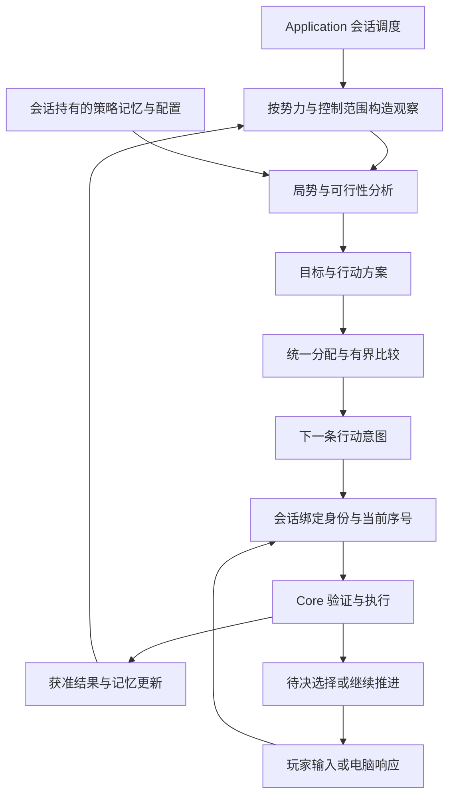

# 游戏 AI 系统设计

- 状态：已确认（AI-01～AI-05 已完成；AI-06 生产收口验收中；最终强度尚未交付）
- 日期：2026-10-12
- 范围：电脑势力自主运行、既有自动军团的权限接入、日内响应、保存与评测
- 性质：基于当前重制规则的自主设计，不复刻原版 AI 算法

## 目标与系统边界

游戏 AI 同时服务于电脑势力和玩家委任军团：电脑势力管理全势力，玩家委任军团只在获准的对象、账户和方针范围内行动。两者使用同一套规划能力，在与玩家相同的玩法规则下维持生存、发展实力、组织战争，并对局势变化作出连贯调整。它输出合法行动和必要的事件选择，领域引擎决定这些行动能否成立以及产生什么结果。

设计以三个问题为起点：当前必须保住什么，有限资源应投向哪里，已经开始的行动如何完成或退出。由此采用“局势分析、目标与方案、统一分配、执行反馈”的结构。旬级决策安排经营与战役，日内响应处理明确的选择，部队移动和战斗仍由公共规则逐日执行。

首版交付一个可解释、可复现的标准策略，覆盖经营、人事、军事、外交和事件。必须能够完成经营、补员、集结、占领和巩固的完整过程，也能在无胜算时减损；不以每旬都出征、命令数量多或单一胜率高作为智能程度。

最终能力目标是：在相同玩法规则、信息权限和可比开局条件下，最高能力档通过决策水平强过大多数熟悉本作规则的老玩家。首版可玩和 G11／G12 的工程验收是中间里程碑，不是这个目标的完成证明。达标须由独立对抗评测确认，不能仅凭算法名称、自动对局胜率或设计意图宣称。

首版不引入在线大模型、训练管线、全局博弈树、战争迷雾新玩法或新委任菜单。可选委任方针的产品设计独立安排，当前已有控制权限和方针限制继续生效。长期全地图对局仍归路线图 G12，不能由局部策略测试代替。

本文是自主 AI 接入的唯一权威计划，集中维护系统设计、实施顺序和完成条件。BEH／DEC 分别维护具体行为与长期取舍，不另行维护一套实施路线；当前已实现行为与接入后的目标行为分开标明。

## 当前代码提供了什么

| 当前入口 | 可复用基础 | 正式接入需解决的问题 |
| --- | --- | --- |
| [AiPlanning.cs](../src/San9.Application/AI/AiPlanning.cs)与[DomesticObservation.cs](../src/San9.Application/AI/DomesticObservation.cs) | 分析随机和预算；经营已具备权限裁剪的不可变观察与纯候选生成 | 经营已接入缺粮目标、保存配置和账户工作账本；AI-05 机会采用独立不可变观察 |
| [AutomaticTurnRunner.cs](../src/San9.Application/AI/AutomaticTurnRunner.cs) | 会话统一执行自动工作与结束控制，电脑直属经营和委任调度接通，电脑根军团不重复调度 | 同一势力批次由 AllocationTurnRunner 共同分配账户、人物及工作额度；战役闭环已接入 AI-04，AI-05 机会及治理候选共用分配 |
| [GameSession.cs](../src/San9.Application/GameSession.cs) | 候选世界、验证、事件聚合和成功发布 | AI-01 策略状态已与候选世界一起发布、回滚；推进入口共用自动调度 |
| [SimulationEngine.cs](../src/San9.Core/Simulation/SimulationEngine.cs)与[ResolutionPipeline.cs](../src/San9.Core/Simulation/ResolutionPipeline.cs) | 公共命令及暂停续行 | 策略响应已统一待决身份与控制者授权；强制规则及玩家直辖搜索／修习例外独立保留 |
| [EconomicOutlook.cs](../src/San9.Core/Simulation/Economy/EconomicOutlook.cs) | 按账户估算收入、薪俸和粮耗 | 已计入在途运输、未来粮食到账、招募与新投送的增量粮耗；收入风险和战役维持仍待扩展 |
| [MilitaryArrivalForecast.cs](../src/San9.Core/Simulation/Movement/MilitaryArrivalForecast.cs) | 复用移动规则的到达估计，区分不可达与未完成 | AI 使用显式 NavigationArrivalInput，共享导航规则及工作计量；原完整世界入口留给公共查询 |
| [SessionProtocol.cs](../src/San9.Application/SessionProtocol.cs)与[SaveService.cs](../src/San9.Application/Persistence/SaveService.cs) | 会话状态、精确恢复、玩家读档与录像基础 | AI-01 已保存缺粮目标、配置身份及参数，并纳入会话摘要；后续领域继续扩展 |
| [HeadlessHost.cs](../src/San9.Headless/HeadlessHost.cs) | 独立进程运行与恢复对照；脚本只为玩家席位下令，电脑使用会话自动调度 | AI-06 增加自主对局、逐势力工作量／耗时与资源趋势报告 |

以上区分已接入能力与后续缺口；AI-06 保留测试工程内的历史有限策略作为旧命令接线证据，不作为生产策略内部继续叠加的骨架。最终强度仍需后续阶段证据。

AI-01 已接入真实缺粮处理：经营观察按控制范围投影实际账户、可用人物、合法购粮报价和共享 `FoodSupplyForecast` 纯规则计算的收获前粮耗；纯规划器比较供养缺口，逐条提交购粮或内政，再按成功效果更新本方资源与承诺。账户与人物只分配当前可支付、可行动的资源；缺粮账户保留资金并停止非训练内政，不能跨军团借钱。缺粮目标保留首次建立日期，在缺口满足或权限撤销时清除；同等缺口优先保留较早承诺。策略配置实际值和活跃目标保存于会话并进入摘要，与世界原子发布／回滚。当前配置为 `domains-v1`、65536 共同工作额度、每批最多 8 次购粮和一条合法内政；实际配置可在创建会话时指定，恢复使用保存值。工作计量覆盖账户／据点／报价投影、购粮比较、内政生成和候选检查；不足时保存目标并明确返回额度耗尽，不消费正式随机。

公开夹具覆盖三种种子的六旬缺粮恢复、存档与录像、自动动作后的外层失败回滚、多账户／共账户、隐藏外方信息、权限撤销、低预算记忆提交及整旬／逐日入口去重。当前存档格式 108、日志格式 112、录像格式 19、规则 v106；旧结构不引入兼容分支。使用到的自动内政旧选择入口已退出生产调度，玩家脚本选择仍为测试／Headless 工具保留。AI-03 将人事、救援、购粮和内政纳入共同分配；AI-04 已替换生产进攻入口，外交与计略的完整机会观察已在 AI-05 迁移，AI-06 清理退出生产的旧策略。AI-02 已完成被俘君主处置与处决继任的电脑响应纵向闭环，其余领域响应仍归 AI-05。

内政观察提前排除本旬已使用、属性已满及设施不支持的活动，避免把已知无效命令交给执行端试错。账户事实与报价完整性分别记录。先为真实供养缺口报价，支援或具体战役产生额外缺口后再按需报价；不为无需求账户提前穷举。购粮比较单人及最多五人的合法组合，在满足同等缺口时优先少占人物，避免单城每旬一次交易被不足的单人额度浪费。账户预测、据点分析和报价均在调用前计费，部分观察只更新已观察账户的目标，保留未观察账户的承诺；最后一笔购粮根据接受效果清理已满足目标，不在额度耗尽后额外生成完整报价。逻辑额度约束上述查询次数及候选工作，基础权限投影和公共查询内部扫描仍随世界规模运行；全领域逐对象计量和调度公平性尚属后续阶段，不能以低预算测试宣称已限制全部计算成本。

### AI-03 已实现行为与证据

同一势力的自动直属范围与自动军团共用 `AllocationWork`，每次只提交一条意图并按实际接受结果更新本方账本与承诺。`SharedAllocator` 在明确账户、合法报价、可用人物和不可变候选之间比较；紧急且及时的救援预留人物及账户粮耗，购粮可使用另一组合。唯一买粮者也需救援时，先满足供养；不能把不同账户的现款合并支付。征兵量受可靠收获前粮食保障约束，调粮计入运输兵及接收驻军的逐日取整粮耗，未来货物不能支付此前的消耗。

经济观察、导航和机会候选生成分别限额，给共同决策及最终提交保留工作额度；报价未遍历完时仍可执行已经验证的购粮方案。救援按敌军与已在途援军的共同时间线计算未覆盖缺口，第一波已有保障时使用下一波缺口的截止时间，未签发候选不计入援军。调将作为救援前置行动时，候选同时包含后续运输的出兵费用及源／接收账户增量粮耗，完整方案当前无法负担时不签发调将；后续下令仍按实际局势重新验证。

到达投影使用显式路线输入、公共移动倍率和粗格近似成本，包含出发准备、已知混乱、余量、途经点与本批次输入完整的缓存。敌军按公开位置投向最近本方驻地，只形成一份联合假设，不读取敌令、隐藏出发延迟或正式随机；时间窗口累计公开兵力与规则战力。候选计入人员调动到下一个下令边界后的投送，缺指挥官时尝试合法调将；调走人物后重算源城防御，并比较政治能力与占用时间的岗位机会成本。未完成搜索、不可达和已知迟到分别表示，已经在途的援军与物资不会再次分配。

这是救援入口的有限威胁模型：按公开位置、最快地形、即时出发和最大攻击范围计算最早到达下界，忽略障碍可能高估敌军机动能力，不把该下界作为本方可达证明。敌方兵力只分配到一个最早可接近的本方驻地，以基础公开能力估算战力，未知统率取 50；无威胁据点保留 3000 兵的基础守备。AI-04 在出征方案中进一步计入驻军动员、行动窗口与战役净价值；联合方案优化归 AI-07。

`AllocationDiagnosticsEnabled` 只控制独立有界诊断，记录观察、候选意图摘要、账户保障、工作量与预测到达；对真实运输记录实际到场、送达兵力和账户耗粮差异。账户实际消耗包含期间其他行动，差异需结合批次输入归因；调将准备候选只记录签发，不能当作后续投送完成。诊断不参与分配、保存或权威摘要，外层事务成功后才发布。

验收见 [SharedAllocationTests](../tests/San9.Application.Tests/SharedAllocationTests.cs) 和 [FoodSupplyTimelineTests](../tests/San9.Core.Tests/FoodSupplyTimelineTests.cs)：三种种子及时救援及真实到场／粮耗／兵损对照、买粮与救援人物竞争、仅有一名买粮者、调将瓶颈及迟到对照、主将离队后的留守、隐藏敌方输入隔离、独立军团账户调粮与在途去重、低额度未完成、共享导航与实际移动对照、保存恢复／录像及诊断开关确定性。
### AI-04 已实现行为与证据

`CampaignObservationCapture` 投影公开据点、公开敌军、获准本方行动与合法购粮报价；`CampaignPlanner` 只消费不可变值，不持有世界、引擎或查询回调。生产调度不再调用旧 `MilitaryPlanner.ChooseCombat`；旧入口在 AI-06 移入测试工程的 `LegacyScripts`，仅保留历史接线证据。军事、救援、准备及巩固候选进入同一 `SharedAllocator`，每条命令成功后刷新实际账本，不预先把备选部队当作已出发。

战役比较当前可用兵力与准备后的能力，按源城防御及驻军动员到场窗口扣除留守，再比较普通攻击、攻墙、快速到达阵型与相容兵法；快速方案同样经过战斗和净价值评价，不为无主城指定专用阵型。保留最优行政人员，允许已经经营但仍在城内的人继续承担留守岗位；缺将时调将，缺士气时按共享基础训练公式估算准备旬数，缺兵时比较征兵，缺粮时先购买完整战役所需粮食。准备按完整方案检查费用和粮耗，同一武将不能重复计入多城贡献，已有人员行程不重复签发。

当前组队仍是有限基线：按有效统率选择至多两人、统一中列，在相容且能作用于设施的兵法中按威力选择；尚未联合比较队数、各队兵力、成员互补和兵法连锁。驻军动员风险主要用于战役留守及占领评估，尚未完整接入日常提前增援。AI-04 完成表示基本战役闭环成立，不表示上述能力已成熟；后续责任见[关键能力与暂缓项承接](#关键能力与暂缓项承接)。

同一目标的贡献按账户合计费用与供养，比较按到达顺序形成的多城组合。可出发等待不超过公共规则的九日上限；预计会师与整体延迟两日的方案均须可行。普通战斗估算复用 `CombatMath`，包含墙体消耗、一天一次的守军反击及围攻强度，兵法用于组合比较，不以预知发动保证胜利。模型最多比较到会师后九十日，攻占时剩余兵力还须覆盖已到场援军的估计残部及未来十二日内的敌方力量；已到场残部保守取累计援军与剩余防守兵力的较小值，不能把增援部队视为墙破后自动消失，也不把已击败兵力重复计入反击。供养覆盖可靠收获前及预计巩固窗口，后者超过当前经济窗口时追加粮食余量。

公开敌军与潜在驻军动员分别投向一个最近候选地点，驻军动员假设保留 1000 兵、占用十日准备并使用公开通用阵型；不读取敌令、实际可行动人物或预抽结果。目标初筛保留六个近处候选及全部既有目标，机动收益以到附近本方据点的距离及最快地形时间下界估分，不构造假想占领世界或逐对精确寻路；优先比较既有承诺及近处目标，每个目标最多比较三座近源城；先完成公开威胁、巩固和已签发部队观察；已有战役时只搜索该承诺仍可能需要的补充兵力，不计算规划器不会选择的新战线，再查询新出征，最后使用剩余额度估算机动收益。敌军及驻军动员共享公开兵力的最早到达下界，不为全图敌军逐对寻路。单条本方路线只占观察初始额度的一半以内，未完成的可选路线不阻塞已验证方案；规划器另保留比较额度。目标基础控制收益、经济收益、机动收益扣除预计损失、天数、金钱和人员岗位成本；这些是 `domains-v1` 的有限策略参数，不是领域公式。敌军反应仍为一份有限联合假设，复杂战术、损失分布和多战线全局优化归 AI-07～AI-09。

`CampaignGoal` 保存目标归属、准备／集结／进攻／巩固／退出／冷却阶段、源城、实际接受的部队身份、首次日期、进展日期和预计行程。行程减少或守军／城墙削弱更新进展；连续停滞超过预计行程加一旬（至少两旬）、易主、外交保护、路线失效、严重损失或供养不可行时退出。撤回通过公共军令执行，不因缺粮拒绝减耗退出，正在有效撤回的部队不每旬改令。退出完成后按目标公开条件保存三旬冷却；条件变化可重新比较。占领后优先巡察、修复和训练，未到场部队优先归入新城，新城无法合法到达时归入其他可达本方据点，守备和巩固满足后移除目标。

观察分别标记必要分析可用、备选搜索完整和未解决的已出发部队。必要分析可用后允许执行已验证方案；备选搜索未完成时保留承诺，未查明的在途部队不能作为撤军证据。状态随候选世界原子提交、保存和录像再生；诊断不影响状态或决策。公开证据见 [CampaignPlanningTests](../tests/San9.Application.Tests/CampaignPlanningTests.cs)：三种种子的真实占领、巩固与恢复／录像，筹粮与训练、征兵与调将瓶颈，多城整体费用及迟到会师，不能维持的占领、停滞冷却、易主撤回、交替佯攻及真实反击对照、隐藏任务输入和低预算未完成。完整 190 年内容与长期强度仍归 AI-06／G12。

### AI-05 已实现行为与证据

生产机会候选由 `OpportunityObservationCapture` 投影合法行动、公开目标、行程、军师意见及当前战役需求；纯 `OpportunityPlanner` 不持有世界或查询回调。有可支付的高优先级方案时，先执行并刷新事实，再生成优先级 5 的普通机会；不会影响当前选择的低优先级候选不提前穷举。登用、搜索、调将与出征的资格投影使用 Core 与提交共用的只读校验，不通过临时世界试执行命令。单次战役观察对同一控制者与同一意图只校验一次，重复访问仍计查询额度，世界刷新后丢弃结果。已完成的行动类别、已有在途尝试和守备不允许离队的人员在军师咨询前剔除，势力总兵力和关系目标在单次观察内共享。外交、计略、搜索和登用与救援、战役、内政共用 `SharedAllocator` 的账户与人物。紧急救援和供养优先，普通机会排在已有战役及支援之后；每条接受的命令后更新本方资源与承诺，整批战略观察不随普通行动重建。机会任务沿用离队后的守备需求，不能扩大源城防御缺口；已有在途人物不再计入留守指挥。跨账户补兵同时检查来源运输／失败返程余量与接收方成功接兵后的增量粮耗，不能借用另一账户余额。旧 `DiplomacyPlanner`、`StrategyPlanner` 和 `PersonnelAllocation` 不再参与生产调度，AI-06 已将前两者移入测试工程的 `LegacyScripts`，删除无人使用的 `PersonnelAllocation`。

军师可靠性使用 Core 公共 `AdviserAccuracy.Percent`，不是行动成功率。机会评价将可见条件先验与有利／不利意见按可靠性合成概率估计，再扣除立即费用和行程中的人员机会成本；完全可靠的意见在咨询范围内取 100%／0%，有误差的意见不一律排除。该合成及评分是有限策略估计，不声称反推出领域真实阈值；不读取咨询内部或任务骰子。无军师保留先验。失败按任务身份或人物与行动目标关联，不串到同人物的其他任务。

会话保存每个控制范围与行动目标的在途尝试和条件冷却，成功保留一旬、失败或取消保留三旬，结束后及时删除；不保存事件历史。公开目标、关系、军师可靠性或人物能力档变化允许重新比较；小幅政治成长不使同条件失败立即失去冷却。恢复校验在途任务身份、执行者、所属、日期和权限，记忆随世界原子发布／回滚。

人事配置独立于任务占用：褒美使用公共资格，无电脑专属开局或周期门；军师任命比较当前有效智力对应的咨询收益，不用固定智力差门槛漏掉达到完全准确的改任机会。官职与宝物比较一个季度的恢复后岗位增益，扣除实际俸禄、撤职或没收引起的忠诚损失，官职比较先剔除被比较官职自身的加成，并按实际新增俸禄评价改任；宝物按公共最高同类增量计算边际收益。短期受伤可以只改任军师，原装备与官职仍按恢复后的价值保留；长期收益改变时允许调整，不设置受伤者禁止调整的分支。当前恢复估计按无伤能力评价长期岗位，不预测具体治疗日。

Core 在需要策略答复时统一产生待决状态，Application 经公共命令回答电脑，玩家保持暂停。已迁移普通搜索即时登用、求仕、联盟逐方参加、攻击请求及俘虏返还的报价／接受、普通拥立、国号、单挑／狙击继任；与既有被俘君主处置及处决继任使用同一协议。电脑报价从公开合法补偿与自身预留后余额选择；攻击请求要求当前可履约且目标为敌，接受付费保留自身预算。联盟先按势力顺序征询玩家，再按势力顺序征询合法电脑，不把未回答的电脑预先计入成员。免费／拒绝收尾、强制废帝、自然死亡继任，以及赠与／劝降的公共自动效果仍是领域规则。玩家直辖特殊搜索表与修习城市资格不机械删除；若产生已支持的委任日任务，响应按其具体提示选择可支付、符合收益的参数。

当前命令覆盖如下；采用表示会评估合法机会，排除表示本版不自动签发该命令，不改变玩家公共能力。

| 命令 | AI-05 生产采用或排除理由 |
| --- | --- |
| `DevelopCommand`、`FoodTradeCommand` | 经营、征兵、训练、修复与缺粮购买；未生成无需求卖粮，避免供养余量来回交易 |
| `SearchCommand`、`RecruitOfficerCommand`、`MoveOfficersCommand` | 城内人员缺口搜索／招募，低忠诚外方人员的登用机会，以及支援、战役前置调将；不扫描未发现人物 |
| `RewardOfficerCommand`、`AppointAdviserCommand`、`AssignOfficesCommand`、`GrantTreasureCommand`、`ConfiscateTreasureCommand` | 忠诚维护、咨询与长期配置候选，经势力级权限验证；玩家委任军团不代行这些任命 |
| `GiftCommand`、`ReturnPrisonerCommand`、`RequestAttackCommand`、`DemandSurrenderCommand` | 赠与针对公开战线压力或潜在战役协同；取回可见本方俘虏；请求协同当前战役；有优势且已实际进攻的目标才劝降，不无目的送礼或开局吞并 |
| `UnitStrategyCommand`、`BurnCommand`、`AlienateCommand`、`SeizeCommand`、`GossipCommand` | 补充友军／士气、干扰敌军、削弱当前战役目标和敌方合作，计入行程和收益；不采用旧日历轮转 |
| `DeployUnitCommand`、`TransportUnitCommand`、`OrderUnitCommand` | 战役、救援、补给、退出及占领接收；复用已有共同分配 |
| `SetUnitPoliciesCommand`、`SelectTacticCommand` | 暂不独立改令：出征已选择公共默认策略及相容兵法，没有另一个经过投影验证的改装净收益方案 |
| `ReleasePrisonerCommand`、`ExecutePrisonerCommand`、`ExileOfficerCommand` | 普通下令暂不主动处置：优先保留登用／交换机会，尚无证明即时释放、处决或驱逐优于保留的候选；被俘君主的待决释放／处决另走正式响应 |
| `ConstructFacilityCommand`、`DemolishFacilityCommand` | 暂不产生：现有战役模型未评价新增阻挡／通道及拆除损失，不能只因合法就施工 |
| `CreateCorpsCommand`、`ChangeCorpsCommand`、`DissolveCorpsCommand` | 暂不产生：沿现有军团和账户分配，尚无组织调整的前后收益投影，不机械拆分城市或跨账户搬钱 |
| `SetCorpsControlCommand`、`SetCorpsDelegationCommand` | 保留现有授权及方针；玩家军团不得修改授予权限，自主势力也不为增加动作而重设控制 |
| `RespondDailyTaskCommand` | 普通招募、谈判和各已支持搜索提示按语义选参数；投资、购买与冲突支出使用真实账户预留后的可支配资源 |
| `AllianceParticipationCommand`、`RespondOfficeRequestCommand`、`RespondEmperorTransferCommand`、`ChooseCountryTitleCommand`、`ChooseTacticStudentCommand` | 只回答合法待决；联合敌对目标、接受求仕、普通拥立、选择可用国号／学生，保持原资格例外 |
| `ChooseCapturedRulerDispositionCommand`、`ChooseExecutionSuccessorCommand`、`ChooseDuelSuccessorCommand`、`ChooseSnipingSuccessorCommand` | 处置及实时合法继任，经势力控制者授权；战略预算耗尽也可继续答复 |
| `WaitCommand`、`ReformUnitCommand`、内部 `StartTaskCommand` | 无收益或预算耗尽时结束控制；整编全局禁用，内部任务只能由公共命令建立 |

证据见 [DomainOpportunityTests](../tests/San9.Application.Tests/DomainOpportunityTests.cs)、既有外交／计略公开命令与委任测试，以及求仕、政治、拥立、单挑、狙击会话中的新增电脑恢复／录像对照。完全可靠与有误差意见、负收益、同条件失败冷却／条件改变、冷却保存恢复、短期受伤保持配置及长期配置调整均有公开夹具。独立进程覆盖正式外交答复、保存和录像。当前策略配置为 `domains-v1`；AI-05 不代表完整内容的强度定标、设施优化或长期对抗验收已完成，相关范围仍见 AI-06～AI-10。

### AI-06 生产切换、标准配置与能力基线

生产只经 `GameSession → AutomaticTurnRunner → AllocationTurnRunner` 及 `AutomaticResponseRunner` 调度，各候选共用合法账户、人物和确定性额度。旧军事、外交及计略策略移入 [LegacyScripts](../tests/San9.Application.Tests/LegacyScripts)，其用例保留历史公共命令接线／地形／权限证据，不作为生产强度证明；无人使用的旧人事分配已删除。玩家经营脚本继续用于经济周期的独立回归，不参与电脑评分。

`GameSession.Start` 的 `playerForceController` 创建时指定剧本玩家势力的控制类型，默认保持玩家；自主评测指定自动，控制者身份和初始玩法内容不变。实际选择进入会话摘要、存档和录像，恢复校验控制配置。命令日志头同时保存控制类型与 AI 配置实际值，从新进程重建时不依赖当前默认值。保存108／日志112／录像19、规则v106；不引入旧结构兼容。

标准配置固定为 `domains-v1 / WorkBudget=65536 / MaximumPurchases=8`，当前只交付此标准策略。Headless 的 `--ai-budget` 是有界评测参数（1～1000000），可进行同场景预算消融；低额度能够合法结束控制、保存承诺和继续答复，不代表已经形成更弱／更强的正式难度档。AI-07～AI-09 只有在任务完成、协同或损失等指标上证明预算收益后再登记档位；不提供任何资源、成功率、战斗或信息优待。

早期生产切换、资格查询和有限占领闭环的测试数据见[性能与验证记录](../docs/ai-performance-records.md)。当前能力边界以下表为准，不以短局样本证明长期强度。

```powershell
# 全部席位使用同一生产路径，默认每势力每旬65536工作单位。
dotnet run --project src/San9.Headless -- verify --scenario local/generated/content/scenario-190-live/scenario.json --strategy autonomous --seed 190 --xuns 6 --output local/generated/verification/ai-06/190-standard-190
# 同条件预算对照；评测结果不得直接称为难度强度证明。
dotnet run --project src/San9.Headless -- verify --scenario local/generated/content/scenario-190-live/scenario.json --strategy autonomous --ai-budget 32768 --seed 190 --xuns 6 --output local/generated/verification/ai-06/190-budget32768-190
# 独立进程录像再生；日志也可从头直接run，或指定initial.save.json精确恢复。
dotnet run --project src/San9.Headless -- replay --scenario local/generated/content/scenario-190-live/scenario.json --recording local/generated/verification/ai-06/190-standard-190/verification.recording.json --report local/generated/verification/ai-06/190-standard-190/replay-report.json
```

`verify` 对照连续执行、周期磁盘恢复、日志重放及录像再生；关闭诊断的恢复会话与开启诊断的连续会话比较世界、AI记忆、事件、稳定会话摘要及最终保存字节。真正的自动待决若未得到答复直接失败，评测脚本不替它补答。合法提前终局结束剩余席位调度。失败将请求、两侧结果与 AI 记忆写入 `divergence.json`，供缩减复现。

报告的 `aiTurns` 给出每势力每批完整工作、领域工作分布、搜索未完成／总额度耗尽、接受／拒绝数量、新建目标数和实际毫秒。耗时仅计连续会话的一次 `EndControl`，包含观察、规划和事务发布，不包含恢复对照；全流程耗时另记。`targetSwitches` 统计新出现的目标身份，不把阶段变化算成换目标。`noCommand` 表示该批没有接受的规划命令，并不把在途行军算作停滞。`aiCheckpoints` 每旬记录各势力据点、部队及驻军兵力、各合法账户金粮、战役数和非冷却战役最长无进展旬数；工作总计、公共拒绝原因、战斗损失／死亡和溃灭未回收人数另列。统计只在外层事务成功后累加，不因128条明细上限丢失；诊断不进入保存或决策。基础权限及公共查询扫描仍不属于逻辑搜索额度，耗时门槛须结合这些成本。

能力登记以本节为 AI-06 基线；后续阶段必须复用统一路径并保留已有证据。

| 能力 | AI-06 实际状态与证据 | 后续承接或最终排除依据 |
| --- | --- | --- |
| 缺粮、合法账户、人事与救援共同分配 | 已实现；`EconomicSessionTests`、`SharedAllocationTests` 覆盖真实恢复、预测与执行、跨账户和离队留守 | AI-07 联合优化，多线分配和主动减损 |
| 准备、集结、占领、巩固与退出 | 已实现有限估算；`CampaignPlanningTests` 三种种子真实占领、反击、停滞及恢复／录像 | AI-07 扩展目标与成员组合，AI-08 检验容错和位置价值 |
| 机会、长期配置与全部已支持待决 | 已实现；`DomainOpportunityTests` 及事件会话测试；`HeadlessProcessTests` 独立进程 | AI-07 增加面向任务的能力建设，AI-08／09 跨期风险与收益 |
| 独立兵法／部队策略切换 | 尚未主动签发，出征已有相容配置 | AI-07 战中调整；AI-08 验证转换收益与持续作战 |
| 设施建设／拆除 | 尚未生成净收益方案 | AI-07 通道与防御方案；AI-08 检验阻挡及拆除损失 |
| 军团创建／调整／解散 | 沿现有合法组织分配，尚未比较组织成本 | AI-07 权限、账户及组织收益；AI-08 检验风险 |
| 无需求卖粮 | 当前只购粮补缺，不生成没有供养投影依据的卖粮 | AI-07 比较超过供养预留后的出售、经营与军事资金收益；不得靠反复买卖增加动作 |
| 普通释放／处决／驱逐 | 保留登用与交换机会；君主待决已有独立响应 | AI-07 比较保留、招募、交换、释放与处置；最终排除仍需收益依据 |
| 邻境预警、野战拦截、轮换、学习与撤出次序 | 有救援、补给和撤回基础，未交付完整专项能力 | AI-07 生成和联合比较；AI-08 后续效果，AI-09 趋势／意图 |
| 候选覆盖 | 战役至多六个近／高经济目标、三座近源城；队员采用有限排序组合，未穷举远目标与互补人员。普通内政仍按据点及人物身份枚举、最多取五人并尝试人数前缀，未按边际收益联合分配发展岗位 | AI-07 用可枚举／已知可行夹具检查漏生成和早筛，接入岗位机会成本及低预算服务公平性；AI-08／09 改善估值／前瞻；增加预算不能弥补这些缺失 |
| 自改控制权限、整编及内部任务 | 最终不自动采用 | 控制权限来自授予者，整编公共规则全局禁用；内部任务必须经公共命令建立 |
| 最高档、人格、训练与老玩家水平 | 尚未证明；标准镜像只验证稳定性 | AI-07～09共同能力及风格深化，AI-10独立对抗；训练保持可选研究 |

## 已采用的优化与未采用尝试

当前规则为 v106；详细测量口径、原始样本、阶段占比和历史验证结果统一见[AI 性能与验证记录](../docs/ai-performance-records.md)。这里仅维护实现状态与取舍，不将冷态、预热、局部探针和不同决策轨迹的数据混作性能承诺。

| 状态 | 优化或尝试 | 当前取舍 |
| --- | --- | --- |
| 已采用 | 候选只读资格查询、业务值相等性比较 | 共用提交前置规则，取消为候选完整试执行和内部身份比较进行JSON编码；保留正式命令身份及外部协议 |
| 已采用 | 减少重复扫描、全世界审计和快照重建 | 正常内部提交不再全量审计；外部创建／恢复仍校验，命令权限及资源资格仍执行；按集合根复用发布快照及消息索引 |
| 已采用 | 减少到达预测次数 | 敌方威胁及位置价值采用廉价下界，先排除必迟组合；本方查询按完整输入依赖在批内复用，不逐日重放导航 |
| 已采用 | 整批观察和计划（v105） | 经济、救援、配置、战役及普通机会按控制批次组织；接受行动后更新本方资源、人员及承诺，普通行动不重建战略观察；新机会可延至下一批 |
| 已采用 | 纯成本查询省略路径构造 | 不回溯端点路径、不写不使用的父节点，实际路线仍独立构造 |
| 已采用 | 简化粗格行军预测（v106） | 中段单格采样、端点仅比较两种轴向折线；避让代价参与选路但不计行军时间。保留共同预算及现有结果缓存，不增加地形缓存或独立预算 |
| 已替代 | 按军事行动反复刷新观察（v104） | 减少重建仍不充分，由整批计划及本方承诺更新替代 |
| 未采用 | 加权A*预测 | 节点减少但预测偏差增加，未确认值得的整旬收益；不保留实验权重参数 |
| 未采用 | 搜索内地形字典及跨查询分页地形缓存 | 未确认稳定整旬收益，增加缓存与内存成本，保持直接地形计算 |
| 未采用 | 完全封闭粗格端点 | 小目标会误报不可达，采用有界端点折线连接 |
| 已撤销 | Native AOT及预录JSON哈希计时程序 | 仅作排除JSON的固定场景实验；正式运行继续使用默认JIT，不将预录哈希作为通用基准 |

粗格预测只供AI战略估算，不证明宽部队能通过狭道，也不承诺抵达日期与实际执行一致；真实移动、精确成本查询及路径显示沿用原导航。用户于2026-10-13确认接入已保留的最终方案，允许决策变化；接入时按用户要求未重跑测试或性能测量；后续全面改动审核清理了无生产调用的逐日预测缓存、合并重复地形取值，并将仅供诊断的据点查询移出正常路径。该审核与提交不代表 AI-06 验收完成。

### 计算组织与预算待复核问题（2026-10-14）

本节记录当前性能实验暴露的问题与建议，不将共享路线试验标记为正式完成，不修改默认预算、阶段完成状态或既定验收范围。测量口径和数据见[候选寻路与预算限制复核](../docs/ai-performance-records.md#2026-10-14候选寻路与预算限制复核)。

| 问题 | 已有证据／实现现状 | 待处理方向与判断边界 |
| --- | --- | --- |
| 相似候选重复计算昂贵事实 | 新出征候选占开局 AI 寻路耗时约 98%；共享少量水陆代表路线使其搜索次数减少约 54% | 按真实输入依赖分离共享路线事实与具体编队评价；跨旬复用须定义失效条件。不能以局部收益宣称整旬已加速 |
| 候选细化发生过早 | 目标、来源、阵形组合在完整战役比较前计算路线，准备方案也估算未来投送 | 检查便宜初筛、主要候选覆盖及少量关键方案细化的次序；不得通过简单减少候选数量掩盖遗漏 |
| 总额度富余但阶段先被截断 | 标准预算 65536，十年实测单回合最高只用 28906；12.67% 势力回合仍未完成，已记录额度耗尽集中在进攻候选收集 | 评估阶段额度回收与按需追加；先解释截断原因，不直接统一翻倍或增加不透明的动态参数 |
| 工作计量与实际成本对应不足 | 搜索展开、候选检查等共用工作额度，实际成本不同；部分基础投影和公共查询内部扫描仍随世界规模执行 | 分开报告逻辑额度、实际耗时与未计量工作；保留确定性，不以机器墙钟时间改变权威决策 |
| 搜索覆盖和停止依据不够透明 | 同局面提高预算既可能增加出征，也可能仅减少未完成数量 | 区分候选已处理完、条件不成立、阶段额度不足、总额度不足；核对排序是否使后续候选长期缺少服务。追加计算收益须以选择与实际结果验证 |
| 增强阶段可能放大当前成本 | AI-07 增加联合组合，AI-08 增加推演，AI-09 增加多步与敌方假设 | 不把 07～09 当作性能会自然改善的承诺；增加搜索维度前复核共享分析、分层细化和成本边界 |

当前判断：尚无证据否定“局势分析、目标与方案、统一分配、执行反馈”的总体结构；已发现计算复用、候选生成及阶段额度分配的具体不足，不能仅归因于参数偏小。原设计已经要求共享分析、需求驱动候选与关键方案精算，实现尚不充分；将更合理的计算分配主要留到 AI-07／08 的实施次序也需要复核。保留领域所有权、共同资源账本、信息权限、确定性和执行反馈，不据本轮实验启动全量重写。

拟议优先顺序：在扩大联合搜索和推演前，先检查共享事实的粒度与生命周期，保证基础轮有合理候选覆盖，再明确细化触发条件和阶段停止原因；是否提前调整阶段调度、如何回收额度，尚待实现对照。验收分别比较同局面成本、同成本选择质量以及规模增长下的开销；长期对局耗时变化、更多命令或更多部队均不能单独证明性能或智能改善。AI-07 可能改善方案组织，但也增加组合成本；AI-08／09 的目标是提高判断能力，必须在有限候选和明确计算边界上建设。

#### 按需中转试验

2026-10-14 审核后接入生产分支，规则版本 v108；仍不代表 AI-06 或后续强度验收完成。共享成本对端点跨岸占地保留每步水陆最大基础消耗，在具体编队加权后再取最大值，避免中性成本相同时漏计较慢地形。缓存仅服务输入相同的路线，跨观察的障碍变化进入缓存键；港口选择只在一次冻结观察内复用。

`codex/ai-route-planning` 分支试验用共享中性地形路线替代固定三种水陆权重搜索。新出征候选先估算直达；仅当编队水上机动力高于陆地、存在合适的已启用己方港口时，额外比较一个港口水侧入口中转。入口须可通行，且到起点、终点的距离均短于起终点直达距离；按总几何距离选择一个入口，再按完整两段预计时间比较，只有更早到达才采用，同值保留直达。路线选择仍随编队能力比较，不把水上优势当作必须渡水的命令。港口候选枚举和路线查询使用原共同额度。

路线估算在同一批次按地图、占地、起终点、障碍及抵达条件复用，土地／水面消耗按各编队机动力换算。选中的中转点写入 `DeployUnitCommand.Waypoint`，经正式提交校验并由公共行军规则执行；不为每个备选中转方案调用精确路径资格检查。准备方案在真正出征时重新观察；当前战役记忆不额外持久化一条过期路线。

该原型仅覆盖一个己方港口控制点，不代表完整的通路选择：不保证全程走水路，不强制避水，不生成多点路线或敌方据点绕行；接战、伪报等仍遵从公共执行规则。它也不保证中性路线估时等于实际按机动力选路的行程。全局路线偏好、风险估值与更广泛的中转候选，需在本试验基础上独立评估，不能由本次性能改善直接推定策略收益。

## 必须保持的不变量

1. Core 独占世界状态、资格、成本、耗时、随机效果和结算；AI 不能直接修改人物、兵力、账户或关系。
2. 一个对象在一次分配中只有一个主要用途；资源以实际账户计量，不能借势力总额跨军团透支。
3. 看得到不等于可以控制。玩家直属范围不能被 AI 调用、预留或改方针。
4. 相同获准信息、记忆、配置、运行种子和工作预算产生相同决策；机器速度、缓存温度和诊断级别不改变结果。
5. 策略记忆与世界属于同一次会话提交；拒绝的外层操作不能留下半份计划或已消费的权威状态。
6. 电脑必须回答自己负责的待决选择；玩家选择必须保留给玩家。推进不能依赖 Godot 界面存在。
7. 长期目标是可撤销的承诺，不是世界资源锁；每次执行重新验证当前事实。
8. 难度改变决策能力和取舍，不暗改资源、效果或信息权限。明确存在的玩法例外按对应规格单独验收。

## 架构与状态所有权



规划代码先留在 `San9.Application.AI`，不增加独立服务或工程。内部按观察、分析、方案、分配、响应和诊断组织，具体文件随真实职责产生。Godot 和 Headless 只发起会话操作，不拥有另一套 AI；Content 保存通用玩法定义，Importer 只负责源格式转换。

| 数据 | 所有者 | 保存与失效 |
| --- | --- | --- |
| 当前世界、控制权、已签发任务 | Core | 使用既有领域保存规则 |
| 活跃目标、战役阶段、跨旬承诺、失败冷却、等待年龄 | Application 会话 | 凡影响未来选择均保存，进入会话摘要；失效按对象和控制范围清理 |
| 策略版本、难度配置、实际参数值 | Application 会话 | 保存可复现的配置值及身份，不依赖读档机器上的可变默认值 |
| 候选、当前批次预留、路线与收支分析 | 单次规划 | 可重建，不保存；缓存键覆盖实际输入依赖 |
| 解释、被淘汰方案、耗时统计 | 诊断输出 | 不进入状态摘要或普通存档，按容量限制保留 |

策略记忆只保留无法从当前世界还原的意图。不能把整份城市资源、人物名单或所有历史命令复制进去。已完成目标移出活跃集合，过期冷却删除；存储量随当前目标和对象规模增长，不随游戏旬数持续增长。

### 决策协议

建议用以下逻辑契约统一现有协议，名称可随实现调整，但数据方向固定：

| 契约 | 必要内容 |
| --- | --- |
| `AiDecisionInput` | 获准观察、控制范围、不可变策略记忆、策略配置、决策用途、剩余工作额度 |
| `AiDecisionResult` | 一条待提交意图或停止原因、关联方案、确定性工作消耗、记忆变更建议、可选解释 |
| `AiActionIntent` | 公共命令语义所需参数、执行权限范围、预期前置条件；不预分配正式序号 |
| `AiExecutionFeedback` | 接受／拒绝、获准效果、关联任务或部队身份、当前边界；不把完整内部事件直接喂回规划器 |
| `AiDecisionPrompt` | 待决身份、响应者、选择类型、获准载荷与合法选项／参数约束 |

规划器无会话、引擎或完整世界引用，也不持有能绕回完整快照的查询回调。纯分析可以组合多个方案，但每次只提交一条当前可执行意图。Application 生成命令身份、绑定最新序号和控制者，经公共 `Execute` 执行，再以结果更新记忆。

目标建立或放弃可能不立即产生领域命令，这类记忆变化在成功的外层会话操作内提交；与出征、调动等绑定的承诺只有在对应命令成功后才记为已执行。拒绝只能记录获准原因与必要冷却，不能把失败命令当作已有部队或在途支援。

## 观察与信息权限

观察由 Application 在明确的势力视角下构造，不复用带完整 `World` 引用的表现层对象。公共资格和估算公式可以下沉或提取为只读规则，但 AI 可访问的查询参数、返回值及拒绝信息同样受视角约束。

下面是首版采用的权限矩阵。它沿用当前公开信息和显示限制，不新增地图迷雾；具体字段随消费能力落地。当前实现的参考位置为[战略投影](../src/San9.Application/Presentation/StrategySnapshot.cs)、[部队详情](../src/San9.Application/Presentation/UnitDetails.cs)和[命令显示](../src/San9.Application/Presentation/OfficerCommands.cs)。

| 信息 | 本方 | 其他势力 | 处理要求 |
| --- | --- | --- | --- |
| 日期、地图拓扑、通用规则、已启用内容 | 可读 | 公共 | 不包含未启用对象或源槽位 |
| 公开势力、据点归属与已公开人物 | 可读 | 按现有公开查询 | 隐藏／未登场人物不提前进入候选 |
| 据点兵力、士气、耐久和公开资源信息 | 完整 | 只投影玩家同条件可查询字段 | 不因内部存在更多字段就扩大权限 |
| 地图可见部队的位置、兵力、阵型与成员 | 完整 | 按公共列表与详情 | 隐匿等领域状态遵从同一可见规则 |
| 部队命令、目标和已装备兵法 | 完整 | 分别受命令、兵法可见设置限制 | 首版对各观察势力采用同一设置语义，实施时同步可见性规格 |
| 部队自主策略、未公开任务载荷 | 完整 | 不可读 | 敌方行为由公开状态估计，不能读取其真实计划 |
| 本方任务、归期、权限与账户归属 | 可读 | 仅公开部分 | 在途资源与立即可用资源分开；军团行动权限另列 |
| 待决选项与谈判内容 | 响应者可读 | 只读已公开结果 | 不泄漏其他响应者的私有选项与报价依据 |
| 本方军师咨询意见及判断可靠性 | 按玩家同条件可获得的意见、本方军师有效智力与公共准确性规则 | 不读取对方私有咨询 | 可靠性属于观察输入，不暴露咨询内部阈值或随机数 |
| 正式随机状态、预抽任务骰子、隐藏触发条件、其他 AI 记忆 | 不可读 | 不可读 | 自己的任务也不暴露未来随机结果 |

未知值、未适用值和零值必须分开。位置或兵力未知时采用明确假设区间，说明风险；不能伪造精确预测。相同获准观察下改变隐藏世界，计划与分析随机应保持一致。

现有到达预测和经济预测不能仅包一层接口就交给规划器。先核对实际依赖，将必要通用计算改成只消费明确输入的共享规则；AI 用获准数据构造估算，Core 执行仍使用权威数据。路线搜索不得通过隐藏占位、真实敌军命令或验证拒绝成为探测接口。

军师咨询采用与玩家相同的信息和规则，AI 根据本方军师的有效智力及该类咨询的准确性规则调整信任程度。规则保证判断完全准确时，在该意见的适用对象、时点和条件内充分信任成功判断，但仍比较行动收益、成本及其他用途；准确率不足时，将意见作为有误差的证据，结合可见局势、失败代价与岗位机会成本取舍，不将“有利／不利”统一作为执行／排除开关。意见可能出错的概率不等同于行动本身的成功概率，不能直接用军师准确率替代成功率；军师智力影响咨询可信度，不直接决定 AI 规划能力。

该原则统一适用于登用、劝降、计略等实际提供军师咨询的行动，由 AI-05 全领域接入时落实与验收。允许有根据的冒险和判断失误；重复尝试沿用目标、失败类型与相关条件的反馈和冷却机制，不能因低准确率意见反复无效投入，也不能因一次随机失败永久放弃。局势或咨询条件变化后重新评估，不将旧意见外推为未来必然结果；不得绕过公共咨询读取隐藏成功率、任务骰子或未来结果，也不添加电脑专属智力门槛。

## 从局势到行动的算法

### 时间和资源的统一表示

所有候选都以领域日期表达出发、到达、完成和资源释放时间。分析窗口覆盖下一次可靠收入／收获、主要敌军可能接敌时间和本方方案完成时间；不假定每项工作都在下一旬完成。

资金和粮食按账户预测，兵力按驻地和在途归属计量，人物按资格和可再次行动日期分配。一个资源项至少区分当前可用、已被领域任务占用、预计到达和本次计划预留。预计收入或援军不能用于当前立即支付；未来不确定收入按风险估计，不作已到账资源。

可用兵力从现有兵力中扣除已执行调动、留守需求和其他已选方案承诺。不能先对所有城市各算一次“可出兵”，再重复加到多个战线。行政军团是权限和账户边界，攻防方向是分析分组，二者不要求一致。

### 局势分析

每轮先形成四类可复用结果：

- **生存压力**：资金／粮食能维持多久，哪座据点可能在何时失守，哪些关键人员存在流失风险。
- **行动能力**：各地可调人员与兵力、合法阵型兵法、到达时间、补充和撤回条件。
- **发展机会**：内政投入的边际收益、人员缺口、外交缓冲和具有实际价值的进攻窗口。
- **现有承诺**：已经派出的力量、在途补给、目标进展及导致继续／缩减／终止的变化。

威胁按目标与时间窗口累计可到达力量，区分当前接敌、近期增援和远期潜力。敌方同一支力量不能在一个联合假设中同时出现在多个地点。对主攻、固守、增援或反击构造少量可行反应，避免把所有敌军的最坏情况同时叠加成永远不敢进攻的判断。

战力估算使用共同的属性、地形、射程、阵型与伤害规则，但不复制一套独立结算器。先算静态能力和可持续作战时间，再对关键方案做有限前瞻。前瞻只使用合法观察构建的局面，不能复制隐藏世界后声称只看公开结果。

### 按收益优先建设共享分析

首轮优先建设按目标与时间窗口组织的共享分析：谁能到、何时到、能投入多少有效力量、能维持多久，以及调走后原驻地的风险。威胁、救援、集结、预备和进攻窗口消费同一组结果，不各自重复计算到达、兵力和账户。分析结果区分已知、假设区间、不可达和预算不足导致的未完成；有效力量保留必要的阵型、地形与任务差异，不能只用总兵数代表战斗能力。

| 建设次序 | 最小可用能力 | 复用与成本边界 |
| --- | --- | --- |
| AI-01 先贯通经济生存 | 按实际账户预测可靠收入前的缺口，用合法购粮或其他可行行动持续补足 | 复用经济规则，先完成真实跨旬目标，不等待军事分析 |
| AI-03 优先到达与投送 | 对候选据点和关键通道，计算准备、调将、出发与行程后的到达窗口及可投入力量 | 复用到达预测的通用计算；先筛候选再计费求路，不从全地图逐格热力图起步 |
| AI-03 合成动态威胁与保障 | 将敌方可能到场力量、本方可救力量、账户粮耗及运输到达放到同一时间窗口 | 威胁与后勤分析使用共同输入；不增加当前玩法没有的独立补给线，不把预计援军当成已到场 |
| AI-04 接入预备与行动窗口 | 根据失守风险、援军到达及行动成本确定留守和可机动预备，识别敌方增援前的可用窗口 | 预备不是固定兵力比例，机会窗口从已有时间与力量分析派生；候选比较计入原驻地风险 |
| AI-04 到 AI-07 深化方案分配 | 比较战略目标净价值，协调战役与多战线，联合优化人员、编队、阵型和兵法 | 先形成可执行方案再深化搜索；战线是分析分组，共用权限约束和资源账本，不独立支配势力总资源 |

上述是能力与数据依赖，不是新增一组必须逐个建立的模块。Threat Map、Supply Map、Opportunity Map 可以先表现为目标与时间窗口上的查询结果；只有实际消费者或性能测量需要时再引入空间图或缓存。缓存须声明观察、日期、方案与规则等真实依赖，相关输入变化后失效；不能把一次已过期估算用于后续命令。

战略价值和效用评分先服务于这些可行方案的比较，拆解收益、损失、时间和机会成本。硬权限、资源守恒和生存优先层不参与任意加权抵消；更高分不能使迟到援军变成及时救援，也不能将无法供养的扩张评成可执行。先验证这些基础判断能减少错误，再增加昂贵推演。

### 目标和方案

目标描述想要改变的世界条件，例如“在敌军到达前保住据点”“恢复可供养的兵力”“取得并守住某城”。方案描述达成目标的一组动作。目标不直接绑定唯一实施方法：缺粮可以购粮、合法输送、缩减计划或撤回部队，分别比较时效和代价。

一个方案包括目标、阶段、参与对象、按账户和日期分解的资源需求、行动依赖、预期效果、风险、继续条件与退出办法。共同行动必须显式表达互补关系，例如两队合击、先调将再出征、先筹粮再扩军；不能把每条命令独立打分后认为总分最高就是可行方案。

候选从具体需求生成：缺口触发补给或招募，威胁触发救援或减损，剩余能力触发发展和进攻。不每旬穷举所有人物与所有命令的笛卡尔积。筛选保留不同优势：快到、低成本、强攻、低风险和保留后手；编号只用于最终平局，不用于截掉所有后编号对象。

### 选择和分配

首版采用确定性分层比较与有界局部改善，不要求求出全局最优：

1. 排除权限、立即支付、对象唯一占用和命令资格不成立的方案。估算不完整的方案不能被当成确定可行。
2. 优先处理有明确截止时间的生存威胁，比较可救程度和损失；全部无法满足时选择合法减损，不因“必须全守住”而无解。
3. 将现有有效承诺与新方案一起分配。新方案要扣除放弃原行动的损失和转向成本，紧急威胁可以覆盖持续性偏好。
4. 对发展与扩张方案比较净价值，在冲突预算内做替换、交换和少量组合搜索，直到额度用尽或不能改善。
5. 从入选方案中取前置条件已满足的下一条意图；提交后修订分配，再决定下一条。

资源账本只有一份批次预留，方案失败、缩小或成功消耗后立即更新。必须先联合分配再确定具体编队，避免第一支部队拿走全部优秀人员。人物的机会成本包括原岗位收益、行程和行动占用，而不只是能力值高低。

经济类收益先转成明确时间窗内的资源增量；战役类收益估算控制、通道、后续威胁与损失，再通过版本化评价参数映射为比较值。不同优先层不直接相加，跨领域映射属于策略参数，不冒充领域公式。分数拆成收益、资源成本、占用成本、风险和转向成本，方便用反例定位偏差。

### 决策可靠性补强

以下能力纳入既有阶段，不另增调度器或独立实施路线。实现必须带来可观察的选择改善，不能只增加标签和诊断字段。

| 能力与阶段 | 决策行为 | 验收重点 |
| --- | --- | --- |
| 瓶颈识别与前置准备，AI-03／04 | 从目标截止时间反推人员、兵力、粮草、准备和行程缺口；生成能解除实际约束的前置行动，并计入其耗时和占用 | 兵足将缺时优先比较调将，不能用继续征兵替代；先筹粮再出征的依赖能成立，准备已来不及则缩小或放弃方案 |
| 方案容错与安全余量，AI-04／08 | AI-04 先检查有限的到达偏差和供养余量，AI-08 再用推演比较伤亡、增援等扰动；同时保留预期收益和失败代价 | 识别稍有偏差就失败的会师或占领方案；有可行稳健替代时能比较采用，不能因无限叠加最坏情况而全部待机 |
| 通道与机动位置价值，AI-04／07 | 基于实际地形、可达性、移动和设施规则，评价目标对救援时间、战线连接、暴露方向和撤回路径的影响；预备驻地按可支援目标及到达窗口比较 | 能区分经济价值相近但机动作用不同的地点；每项通道收益可追溯到真实规则，不凭地图外观虚构封锁或补给线效果 |
| 按决策重要性分配计算，AI-07／08 | 先给必要生存判断及合法候选留出额度，再依据投入规模、截止时间、选择差距和撤回代价，将剩余额度用于关键比较 | 同一输入与预算得到同一分配；关键出征获得更充分比较，普通任务不长期饿死；计入分配本身的工作，额度耗尽保留已验证候选或明确停止 |
| 预测与结果对照，从 AI-03 起 | 在受控诊断中关联方案、命令和实际结果，比较预计与实际到达、粮耗、损失；区分输入变化、预测偏差、候选遗漏、分配错误与执行失效 | 能复现具体误差并定位原因；单次坏运气不被当成模型必错，计划取消不算正常完成；诊断开关不改变行为 |
| 可利用弱点专项测试，从 AI-04 起 | 用固定对手脚本和可复现局面检验反复诱援、佯攻调走预备、交替威胁造成改令振荡等套路，逐步纳入历史回归 | 不能被简单重复套路稳定利用，也不能靠永久不救援或不出征“通过”；同时保留真实威胁下应救援和应转向的对照 |

容错检查的扰动范围来自已知误差、公开规则或明确假设，记录选择依据；涉及随机效果时比较分布与失败代价，不要求每次结算吻合点预测。生死存亡时仍允许有理由的冒险，安全余量随后果和处境变化，不设所有势力通用的固定保守比例。

预测对照先用于离线校准与开发诊断，按容量限制记录，不把整段对局历史塞入普通存档。若未来用误差反馈自动改变生产决策，必须另行定义配置版本、可保存状态、更新边界和重放测试；不得借诊断引入隐式在线学习。开发用权威结果与规划器获准反馈分开，敌方隐藏结果不能回流为 AI 情报。

### 跨旬持续与重规划

战役按“准备、集结、执行、巩固、退出”组织。只有入选并需要跨旬持续的方案进入记忆，小额当旬内政不建立长期项目。每阶段都定义完成条件与进展量：准备缺口减少、预计会合时间改善、有效距离减少、目标兵力削弱或占领稳定。

重规划发生在自己的合法下令边界，或领域已经提供的响应边界。据点易主、外交保护、主将离队、路线失败和严重损失令对应方案失效；这不赋予 AI 在日内任意重发军令的权限。日内自主撤退等能力仍通过双方共享的部队策略执行。

普通转向要求收益足以覆盖转换成本，连续无进展按阶段和实际行程判断。失败冷却关联目标、失败类型和相关条件；条件已变化时允许重试，不能固定封禁有效目标。所有目标都不可行时明确等待并保留原因，不构造无意义任务。

## 领域能力与命令覆盖

以下以当前 [GameCommand](../src/San9.Core/Simulation/GameCommand.cs) 注册的命令语义为起点。自主选择表示首版需要评估该能力，不要求每轮使用；响应命令只在对应待决状态下产生。内部任务和全局禁用命令不进入候选。后续新增公共命令必须明确落入哪类，而不是默认 AI 自动获得支持。

AI-05 的人员任命与宝物、官职配置按决策持续时间评价收益，不共用当天有效能力排名作为唯一依据。军师任命考虑当前咨询需求和可靠性，短期伤势可使临时替代更有价值；宝物与官职配置同时考虑获准信息下的恢复预期、恢复后的能力、长期岗位收益，以及公共规则中的调整代价和原持有者损失。候选应包含只换军师而保留原配置、等待恢复及必要的组合调整，不能把更换军师自动绑定到没收宝物或撤换官职。恢复时间不确定时采用明确区间，不预知治疗结果；仅在一段时间内的净收益足以支持调整时重新配置，不另设受伤者禁止调整的特判，也不虚构规则成本。恢复后重新比较任命价值，不机械换回或反复转交。

| 能力 | 公共命令 | 选择依据与边界 |
| --- | --- | --- |
| 内政、征兵、训练、修复 | `DevelopCommand` | 比较活动的实际增益与占用；征兵受兵源、军事需求和可供养能力约束 |
| 粮食买卖 | `FoodTradeCommand` | 优先解决可解的账户缺口，计入商人条件、价格和未来消耗，不无目的来回交易 |
| 人员补充与配置 | `SearchCommand`、`RecruitOfficerCommand`、`MoveOfficersCommand` | 先识别岗位缺口，再比较成功预期、行程及原岗位损失，不硬编码人物名单 |
| 忠诚、官职、军师与宝物 | `RewardOfficerCommand`、`AssignOfficesCommand`、`AppointAdviserCommand`、`GrantTreasureCommand`、`ConfiscateTreasureCommand` | 忠诚风险与实际规则收益进入共同预算；褒美无电脑专属开局等待或编号窗口，不反复改任和转交 |
| 俘虏和人员处置 | `ReleasePrisonerCommand`、`ExecutePrisonerCommand`、`ExileOfficerCommand` | 比较招募、关系和人员损失；破坏性选择需要明确收益，不用低能力排名机械驱逐 |
| 部队投送 | `DeployUnitCommand`、`TransportUnitCommand` | 共同选择人员、兵力、阵型、出发地与时机，检验到达、粮耗、留守和接收能力 |
| 部队控制 | `OrderUnitCommand`、`SetUnitPoliciesCommand`、`SelectTacticCommand` | 围绕任务选择军令、兵法和自动策略；仅在公共资格允许的时机改变 |
| 设施 | `ConstructFacilityCommand`、`DemolishFacilityCommand` | 评估实际阻挡、支援或通道价值，扣除建造时间、费用和拆除损失 |
| 外交 | `GiftCommand`、`RequestAttackCommand`、`DemandSurrenderCommand`、`ReturnPrisonerCommand` | 服务于缓和战线、协同、取回人员或扩张；使者、货物和谈判成本与军事经营竞争 |
| 计略 | `BurnCommand`、`AlienateCommand`、`SeizeCommand`、`GossipCommand`、`UnitStrategyCommand` | 评估目标价值、时间、成功预期与机会成本；不读预抽结果，不因合法就执行 |
| 军团治理 | `CreateCorpsCommand`、`ChangeCorpsCommand`、`DissolveCorpsCommand` | 仅在合法授权下按实际战线和账户需求组织，不复制原版城市阈值与按人数机械分账 |
| 控制和委任设置 | `SetCorpsControlCommand`、`SetCorpsDelegationCommand` | 自主势力可在自身治理权限内配置；玩家势力中的 AI 不改玩家授予的权限与方针 |
| 日任务选择 | `RespondDailyTaskCommand` | 按具体搜索、谈判、投资等语义评估载荷与合法参数，不能统一为接受／拒绝 |
| 政治和学习响应 | `AllianceParticipationCommand`、`RespondOfficeRequestCommand`、`RespondEmperorTransferCommand`、`ChooseCountryTitleCommand`、`ChooseTacticStudentCommand` | 只回答本方合法选择，分别按战略、人员和实际规则收益处理 |
| 君主处置和继任响应 | `ChooseCapturedRulerDispositionCommand`、`ChooseSnipingSuccessorCommand`、`ChooseDuelSuccessorCommand`、`ChooseExecutionSuccessorCommand` | 在 Core 提供的合法结果空间内选择；强制规则不改成策略选项 |
| 收尾 | `WaitCommand`及会话结束控制 | 明确无有益动作或预算耗尽；结束控制由调度器执行，不靠重复等待命令制造进展 |
| 排除 | `ReformUnitCommand`、内部 `StartTaskCommand` | 整编全局禁用，不生成、评分或模拟；内部任务由公共命令建立，不直接签发 |

经营首先满足可持续运行，再投入发展。人物不默认按最高能力全部投入一项活动，须计算边际贡献和其余岗位需求。外交、计略与军事读取同一目标状态，关系变化立即使不再合法的进攻承诺失效。在途使者、调将与补给计入已有投入，避免重复发送。

军事首版包含守备、及时救援、协同进攻、补给、撤回与占领巩固。留守兵力随威胁、地形和援军时间变化。集结用到达窗口与最低有效力量判断，不能以“都已出发”视作完成；攻占之后还要评估治安、守备、粮耗和能否抵御反击。不增加当前玩法不存在的独立补给线或自动瞬移调拨。

玩家势力的自动军团只使用获准控制的对象与账户。同一势力的多个自动范围在一个协调批次中处理，共享资源冲突检查，再分别以合法控制者身份提交；不各自建立一份势力总额预算。跨军团协调只能经双方都受约束的治理或调动命令实现。

## 会话调度与日内选择

### 单一生产入口

会话自动调度负责三件事：执行当前席位的自动工作、结束该席位、在推进暂停时回答电脑待决选择。`EndControlOperation`、`PrepareAdvanceOperation`、`AdvanceOperation` 和 `AdvanceDayOperation` 共用这套调度规则，不能根据从客户端还是 CLI 调用而产生不同决策。

保留当前重制版控制顺序：新局玩家势力在前，其余势力按 ID 排列，按当前控制序列执行；不改成同时规划。即时命令成功后影响后续势力的获准观察，有耗时任务走共同日级推进。接受既有先后手差异，不把同步下令或联机公平性作为此次接入前置。

一次自动控制批次按以下顺序执行：

1. 从候选世界确定本次合法控制范围，清理该范围失效承诺，创建本轮唯一工作账本。
2. 构造观察，分析需求，建立或修订方案，分配资源并提出下一条意图。
3. 绑定当前身份和序号，经公共入口执行。成功则处理获准反馈；拒绝则分类修复或停止该方案。
4. 后续规划沿用剩余预算，根据当前状态刷新必要分析，不重新获得整轮额度。
5. 没有有益合法行动或可选预算耗尽时结束控制；轮到玩家响应则向调用端返回。

调度不新增隐藏的“已经运行过”静态集合，以现有控制进度、正式任务和显式会话状态确定执行边界。分步准备再逐日推进，与直接推进一旬在相同外部操作语义下产生一致结果。脚本玩家仍可向其席位下令，自主席位只由会话自动规划，Headless 不提前再调用一遍策略。

### 电脑响应协议

Core 在规则需要选择时产生待决状态和合法选项，随后退出当前结算调用；Application 判断响应所有者并选择。Core 不在持有可变世界的调用栈内反调 AI，AI 也不通过伪装玩家绕过授权。

需要核对两类现有分支：玩家已经可以选择而电脑直接采用固定答案的分支，以及资格本身按控制者区别处理的分支。前者将策略选择移至 Application；后者先区分设计上的辅助／例外与技术性玩家门，再同步对应行为规格。不能把所有 `Player` 条件机械删除，例如[修习报名](../src/San9.Core/Simulation/Personnel/TacticStudy.cs)还涉及城市和军团资格。

响应授权检查待决身份、当前阶段、响应势力及合法控制者，不要求该势力恰好是旬级活动席位。势力级政治和继任选择归势力控制者；任务／军团级选择按该任务的合法控制范围归属，不能仅因处于玩家势力就全部弹给玩家。首个贯通场景选择[被俘君主处置](../src/San9.Core/Simulation/Personnel/CapturedRulerDisposition.cs)，同时覆盖释放、处决及可能产生的继任续行。

响应类型使用专用参数与评价，不强行压成布尔值。资金报价等空间由公共约束确定可行范围，AI 生成有界代表点并保留规则定义的可完成选项。强制领域结果继续自动结算，不人为制造待决状态。

电脑响应采用独立的有界求值额度，战略预算耗尽不影响响应。无法深入比较时按该类型明示的默认偏好选择合法选项；默认偏好只降低决策质量，不能跳过选择或修改资格。每次响应必须推进任务步骤、消除当前选择或进入新的有效选择；同一待决身份与阶段重复出现且无进展视为错误，输出可复现故障，不无限循环或伪造成功。

电脑连续响应完成后继续原结算，遇到玩家选择、合法日／旬返回点或终局停止。电脑选择链暂不增加中途存档协议，仍沿用完整旬结算后的稳定保存边界。终局立即结束自动调度，不再生成经营或军事命令。

当前 AI-02 实现：Core 的 `GetPendingResponse` 返回待决类型、含阶段的稳定身份和响应所有者；被俘君主提示提供规则合法动作及拘押方获准观察的信望、俘虏能力、关系和联盟资格，处决继任提示提供本势力候选。两类响应不以玩家控制作为资格门，授权仍复验势力、控制者、人物与当前待决状态，军团控制者不能代答势力政治选择。

`AutomaticResponseRunner` 在共同会话事务内使用公共命令提交电脑答复，独立保留两项处置求值额度，不消耗经营预算。现阶段联盟目标优先处决；其余处置沿用基础信望、当前最高能力和关系的有限偏好公式，以命名分析随机判定，不消费领域随机。无比较额度时优先合法释放；继任显式选择规则定义的自动排序（`SuccessorId: null`），不需要可选搜索。此有限偏好是重制策略，不把原作电脑投骰固化为领域规则。

电脑链在玩家待决、原日／旬返回点或终局停止，整旬与逐日入口保留各自续行范围；客户端结算帧覆盖自动答复后的日进展。录像只记录外部操作，重放再生内部答复。未知电脑响应、公共提交拒绝、规则异常和无进展重复身份分别返回稳定故障码及类型、身份和控制者，世界、AI 状态、记录、帧及操作水位整体回滚。公开测试覆盖电脑释放／处决／继任、玩家等待、低战略预算、日／旬／显式结束控制的一致选择、终局、保存恢复、录像再生及重复身份故障。命令完成通知随外部操作的续行范围返回，因此整旬与逐日流中该通知的相对位置可不同，领域事件与命令身份一致。

### 失败与事务

| 情形 | 处理 |
| --- | --- |
| 人物、账户或权限变化 | 删除失效预留，在剩余额度中重新分配 |
| 目标易主、外交保护或引用失效 | 终止对应方案，按合法命令重定向已出发力量 |
| 路线确定不可达 | 比较其他目标或路线，记录有失效条件的冷却 |
| 路线求值未完成 | 记为预算不足，不当作不可达，也不永久排除目标 |
| 某条候选被拒绝 | 不占正式序号；同一状态与参数不无界重试；获准拒绝信息不能用于探测隐藏事实 |
| 已接受第一条、第二条被拒绝 | 保留当前候选事务内第一条结果，调整后续动作；不能凭空退款或收回部队 |
| 外层会话操作失败 | 候选世界、策略记忆、记录与水位一起回滚，不发布半完成结果 |
| 违反不变量、未知响应或规划器异常 | 报告实现故障；不能用通用等待吞掉问题并宣称正常自动运行 |

## 确定性与计算成本

分析随机基于当前运行种子、观察势力、领域日期和命名用途稳定派生，不读取世界摘要或正式随机流。策略和配置是决策输入，随机样本只是估值工具，不提供未来结算结果。对象遍历、平局比较、整数运算和集合输出顺序明确固定；首版不引入并发搜索。

工作预算分为候选构造、路线展开、方案求值、局部改善、可选推演和提交尝试。不是只在最外层计一次 `Plan` 调用：大循环、路径节点和模拟步都必须有界。创建观察的必要线性扫描单独计量，不能以低预算截掉部分世界后假装信息完整；搜索额度可以按获准对象规模确定性增长。

各类工作设总额度与子额度，子任务不得自行创建无限预算。批次共享分析按完整输入记录已处理的路线任务，同一任务只计算一次，重复消费仍计查询工作；未完成任务只有在获配额度增加时才重新搜索。该任务账本每个控制批次重建，不跨保存边界或批次预热。导航内部物理缓存不改变逻辑扩展计费。重规划共享本轮余额，响应使用独立保留额度。停止原因至少区分无需求、无合法方案、收益不足、预算耗尽和规则故障。

低预算优先完成生存判断与已有承诺维护，再扩展普通机会；效用相近时使用等待年龄抑制长期饥饿，最终用稳定身份消除平局。增加预算扩大候选覆盖、组合改善或前瞻，不仅重复计算原候选。具体额度由公开场景和全地图测量定标，不在设计阶段任意承诺毫秒或节点常数。

性能报告同时保留逻辑工作量与墙钟耗时，并注明机器、内容规模、策略版本和配置。耗时用于诊断及性能门槛，不决定权威搜索何时结束。缓存或增量分析只在测量证明必要后加入，键包括观察依赖、规则和配置，冷／暖缓存及恢复后的空缓存决策必须一致。

## 保存恢复与策略生命周期

`SessionSnapshot` 增加 AI 状态和版本化配置，会话摘要包含它们，Core 世界摘要不承担 Application 状态。捕获缓存不能只看世界引用：即便世界未变，目标或配置变化也必须失效。普通存档继续允许合法手工修改，不重新加入存档完整性哈希；载入验证字段、范围、身份引用与状态不变量。

| 操作 | AI 状态处理 |
| --- | --- |
| 新局或动态创建势力 | 初始化对应控制范围的空承诺和确定配置，首次合法边界开始规划 |
| 精确恢复 | 保留记忆、配置和运行种子，后续命令及会话摘要与连续运行一致 |
| 玩家读档 | 沿用现有更换运行种子的规则，保留目标与有效承诺；允许抽样变化，不重置战役 |
| 玩家接回一个军团 | 只清理该范围自动承诺和预留，其他军团计划保留；已签发任务按领域规则继续 |
| 转为电脑控制 | 从当前真实状态建立计划，不恢复已撤销旧命令 |
| 军团合并／解散、人员转属、据点易主 | 按当前归属修订或撤销受影响承诺，不复制旧账户或重复计入对象 |
| 势力灭亡与终局 | 移除失效活跃计划，终止自动工作 |

影响后续决策的跨稳定边界游标、冷却和等待年龄都属于记忆，不能藏在规划器实例。瞬时预算账本和分析缓存不保存，因为本设计不在自动批次内部提供保存边界。游戏显示诊断不需要保存完整候选历史。

协议结构变更按既有严格格式版本处理，不把旧档缺失的 AI 状态默认为空后悄悄续跑。策略算法版本纳入规则身份并单独可追溯；沿用当前规则版本差异告警机制，不承诺不同算法版本的精确重放。配置数据结构不支持时明确拒绝，不保留旧规划器作兼容执行路径。

录像保留外部会话操作，由同一会话确定性再生自动命令与电脑响应，并核验事件和最终会话摘要。内部 AI 命令不同时作为独立外部请求重放，防止执行两次。发生差异时诊断记录第一个自动决策边界、输入身份和选择；本次不建设跨策略版本的结果录像播放器。

## 诊断、难度与可扩展性

每次决策的最小解释包括：要解决的需求、选中目标、使用的账户／人员、预计完成时间、主要风险、淘汰备选的关键原因和停止原因。详细诊断可记录分项评分，但只能解释已计费的计算，不能为了生成解释额外搜索并改变随机状态。

诊断分为自动测试可读的稳定原因码和便于人读的文字，不以中文文本作为程序判断依据。开发日志可以包含调试数据，面向玩家显示时必须再次按信息权限裁剪，不能泄漏敌方未公开计划。首版先接 Headless 报告，不为诊断强制新增客户端菜单。

先固定一个标准策略建立基线，再形成预算与策略参数不同的难度档位。低档仍能生存和合法续行，高档通过更好的候选、协调、估值或前瞻获得优势。对每档保存实际参数，不仅保存名称；难度切换若以后开放，应是可记录的显式会话操作，首版不增加该菜单。

电脑专属的额外士兵、金粮补发、收入倍率、维护减免、战斗或成功率加成、隐藏情报及预知随机结果，均不得用于实现难度提升或最高能力目标。剧本原有势力差异与明确玩法特性可以保留，但不能把有利开局或针对玩家的电脑合谋计作决策优势；高水平评测须控制这些因素。

人格与难度独立，势力差异共用同一套强决策能力，具体设计见下节。Mod 的对象、地图和规则规模不能被固定编号、人物榜单、城市数量或原版槽位限制；缺少合法玩法能力时明确报告，不能越过内容契约补造资源或指令。

### 共享能力与势力风格

不同势力应具有可辨识的决策风格。以持续增强的统一 AI 为基础，通过显式偏好影响目标价值、方案评价与承诺持续性，不为每个势力另写规划器、独立算法或按势力 ID 分支的脚本。威胁评估、战力投送、编队、搜索、推演、权限和执行机制共用，能力改进可以惠及所有风格。

| 因素 | 决定什么 | 与其他因素的边界 |
| --- | --- | --- |
| 难度与能力配置 | 候选覆盖、估值精度、搜索与推演深度、确定性工作预算 | 回答“能判断得多好”，不决定势力必须好战或保守 |
| 势力风格 | 扩张节奏、风险容忍、预备偏好、长期投资、外交合作及承诺倾向 | 回答“在合理方案间偏好什么”，不改变规则、情报或资源 |
| 当前处境 | 实力、地理、敌情、收支、关系与已经执行的任务 | 决定哪些方案实际可行；同一风格在强弱势下应采取不同策略 |
| 委任方针与控制权限 | 允许操作的对象、账户、目标和行为范围 | 属于硬边界，风格不能改写玩家方针或接管直属军团 |

风格维度采用少量有明确行为含义的参数，例如更偏好集中决战还是保留预备、更早扩张还是先提高供养能力、更重视外交缓冲还是独立作战。使用连续偏好形成组合，不把所有势力锁进几个互斥职业；具体参数随真实策略消费者落地，不先堆出大量无效果标签。

风格必须参与目标和方案比较，而不只在最后随机换一条命令；候选生成仍保留必要的替代方案，不能让偏好过早裁掉救命动作。进取型也要检查粮草和退路，谨慎型也应把握明确的低风险收益，合作型不能无条件送礼。资格、信息权限和基本生存要求先于风格，败局中的合理冒险仍由实际可救程度判断。

采用强能力底座不意味着每种风格都必然等强。偏好改变可能牺牲部分纯胜率，因此在同难度、同预算、可比开局下分别测量行为差异、能力下限和可利用弱点，必要时收窄参数范围。最高能力档的每个正式风格都需接受强度评测，不能把统一基线的胜绩直接算给所有变体；默认体验可以在明确定位下提供更鲜明的风格。

风格来源使用 Content 中作者可配置的语义定义与引用，可由剧本指定；未指定时采用明确的中性默认配置，不按原版势力编号猜测。首个风格版本采用稳定的势力级配置，君主继任不自动换人格；以后若引入君主、都督个性，应显式定义组合优先级与切换时机，不能让一次人物变动无条件推翻正在进行的战役。玩家委任军团先服从方针，再在合法方案间表达风格。

实际风格参数与版本纳入已有策略配置的保存和会话摘要；局势适应由当前观察与显式记忆推导，不另藏可变状态。若以后需要随机生成风格，只在定义好的初始化边界用独立确定性随机生成并保存，不每旬重抽或因普通读档改换性格。

实施上先使中性策略具备可靠的共同分析与分配能力，再接少量对比鲜明的风格，以相同局势测试扩张、预备和外交选择的差异；无需等待最强档全部完成，后续随能力升级共同复验。验收还须证明风格在紧急处境下能合理调整、长期可辨识但不机械重复，且无法被一种固定诱导稳定利用。人格只增加配置和评价差异，不建立第二套生产 AI。

### 能力递进与最终强度

以下层次描述研发能力，不直接对应玩家难度菜单。电脑势力和玩家委任军团共用能力，后者始终受授权范围与方针限制；单个军团不会因此获得全势力控制权。

| 层次 | 重点能力 | 进入下一层的证据 |
| --- | --- | --- |
| 第一层 完整自主运行 | 生存经营、人员调动、合法编队、基本威胁与战力投送、全领域命令和响应、持续目标 | G11 完整闭环通过；G12 长期运行稳定，无系统性停滞、透支或权限漏洞 |
| 第二层 协同与方案优化 | 多方向资源协调、留守与预备、跨城集结、武将／阵型／兵法联合搜索，计入到达时间、后勤和机会成本 | 在固定与未参与调参的场景中，相对第一层减少错配和无效损失，提高及时救援、合力进攻与巩固能力 |
| 第三层 对抗前瞻 | 有界兵棋推演，比较对手固守、增援、反击等反应；结合意图假设和不确定性，比较多步行动与退出方案 | 相对第二层的模块对照有可重复收益，能处理诱敌、牵制、反击窗口及多线压力，不只战胜自身策略 |
| 第四层 老玩家水平对抗 | 将前述能力整合到完整对局，针对真实对手暴露的弱点改善评估、候选与搜索，在未见局势中保持有效 | 按下文老玩家对抗协议证明强过评测人群中的多数，且没有依赖数值优待、信息越权或规则缺陷 |

第二层和第三层的基础能力从 G11 开始接入，表中层次表示深化程度，不要求等前一层全部结束才探索下一层。AI-07～AI-10 明确安排协同优化、兵棋推演、多步对抗和老玩家评测；具体算法与任务规模根据上一层的失败场景和性能结果细化，继续维护在本文。高水平对抗是明确的交付目标，不以“首版够用”取消。

威胁评估、战力投送和协同规划是必需能力；兵棋推演逐步从少量关键方案扩展到多步对抗。具体搜索算法可替换，昂贵模块须证明收益；若现有方法达不到最终目标，应改进方法，不降低目标或补发资源。学习与自我对弈是可选技术路线，不是先验必需条件。

最高能力档与默认体验分开：默认档可以按玩家经验提供适宜挑战，最高档保留经验证的决策能力。降低难度也通过规划预算、候选质量与风险取舍实现，不要求玩家必须面对最强策略。

### 搜索和训练的后续空间

保留利用更多计算提高决策能力的方向：启发式给搜索顺序和初始评价，不能把经验阈值固化成无法探索的策略边界。增加搜索只有在固定条件和未参与调参的场景中产生收益才保留；没有收益时先查候选遗漏、评估偏差和重复工作。

游戏规则和模拟吞吐稳定后，可以研究自我对弈、策略／价值学习和搜索结合。此前关于《The Bitter Lesson》及 AlphaGo Master／AlphaGo Zero 的启发保留为研究方向，不把它们当成当前算法、相同训练流程或性能承诺，也不为训练预建接口。

研究须考虑多势力互动、长时程回报、动作组合及信息权限，使用固定基线、历史版本和不同对手验证泛化，并区分有效策略、规则漏洞和奖励投机。训练模型、配置与评测数据需要版本化；推理确定性和保存重放届时另行设计。科研价值可以是发现盲点和形成可复现实验，不等于产品默认对手必须最强；挑战性、可理解性和玩家成长空间分别评估。

以下作为后续探索清单，仅在对应瓶颈出现且具备验证条件时启动；不是 AI-01～AI-10 的新增前置，也不替代必需的协同、推演和强度验收。

| 可选方向 | 启动条件与小规模实验 | 采用条件 |
| --- | --- | --- |
| 离线参数优化与策略／价值学习 | 有稳定基线和足够公开观察样本后，先优化少量评价参数或候选排序，再考虑更大模型 | 未参与调参的局势有收益，模型与配置可版本化，生产推理可复现；不直接学习隐藏真相 |
| 多策略自我对弈与课程训练 | 模拟吞吐允许时，从典型攻防局面扩展到完整多势力对局，用历史版本和多风格对手训练 | 对独立对手有泛化收益，排除规则漏洞和奖励投机；不以镜像胜率代替人类评测 |
| 自动生成反制场景与失败缩减 | 积累实际失败后，在合法地图和世界约束内扰动兵力、时间与资源，并缩减为可复现案例 | 能找到人工夹具遗漏的弱点，缩减后仍保留失败因果；开发发现集与最终留出评测分开 |
| 多精度推演与搜索结果复用 | 详细推演成为实测瓶颈时，尝试粗估筛选、关键候选精算，或复用输入仍有效的分析结果 | 误差可校准且节省计算；缓存命中与否不改变逻辑额度和决策，不能复用失效或含隐藏数据的结果 |
| 有限对手适应 | 固定多假设模型仍反复失误时，按获准的历史行动识别倾向，先用少量可解释参数实验 | 有限样本下不过拟合，遇到对手变招可修正；影响选择的状态有界保存，不读取玩家身份或未公开操作 |
| 多势力合作与承诺推理 | 基础外交和双边对抗可靠后，研究第三方介入、共同威胁、联盟收益和承诺可信度 | 仅经已有公共外交能力实施，各势力按自身利益决策；不得演变为针对玩家的无条件合谋 |

新实验先以可替换的分析或评价实现验证，证明收益后再并入唯一生产路径。暂不建设通用训练平台、第二套模拟器或在线大模型决策服务；若研究需要新增玩法能力，须单独定义玩家同样可用的规则。

## 实施顺序与阶段出口

AI-01～AI-06 是 G11 内部施工顺序，AI-07～AI-10 是持续增强与最终强度验收阶段，使用独立标识，不改变路线图 G11／G12 的整体职责。后四阶段是本计划的正式交付范围，不属于可选训练研究。每一步必须交付可运行行为与对应测试，不先提交成批空接口。

### 完整自主运行：AI-01～AI-06

| 步骤 | 交付 | 出口 |
| --- | --- | --- |
| AI-01 会话纵向闭环（已完成） | 最小真实观察、权限投影、统一调度、工作账本、策略状态保存；用真实缺粮处理和跨旬恢复目标贯通 | 新入口完成合法经营；恢复、事务回滚、信息隔离、入口去重通过；使用到的旧经营路径退出该范围 |
| AI-02 响应纵向闭环（已完成） | 被俘君主处置及继任续行接入响应所有权、合法选项和公共提交 | 电脑释放／处决后能继续推进，玩家仍等待输入；战略额度耗尽不挂起；未知响应明确失败 |
| AI-03 经营与共同分配（已完成） | 先贯通共享的到达窗口与有效投送，再合成动态威胁、账户保障、人员供给和岗位机会成本；购粮、内政、人事、救援竞争同一预算 | 可解缺粮得到解决，能及时支援的局面作出有效行动；区分迟到与搜索未完成，计入准备和调将，不能到达时不盲目抽空后方；多账户、多军团无重复占用 |
| AI-04 战役闭环（已完成） | 复用时间窗口分析，接入动态留守与预备、进攻窗口和目标净价值；协调多城力量、阵型兵法组合、补给、巩固、撤回和失效修复 | 完成经营到占领闭环；有兵但迟到、能占领但不能维持等局面不误判为可行优势；面对反击、易主、结盟和无进展有实际应对 |
| AI-05 全领域贯通（已完成） | 外交、计略、治理、其余日任务和政治人事响应进入同一目标与分配体系；军师意见按公共准确性规则参与评价 | 命令表逐项有采用策略或排除理由，全部支持的电脑响应无需 UI，既有委任限制与玩家权限保持；不同军师可靠性及重复失败反馈通过对照验收 |
| AI-06 生产切换与能力定标 | 清除退出生产的旧策略、整理测试基线、难度和报告，190 年完整内容及独立进程验收；核对暂缓能力及后续承接 | 唯一生产入口，完成场景对照、自动对局、保存与录像核验，登记性能、能力局限和 G12 输入；每项暂缓能力有明确阶段或最终排除理由，不以“暂不”无限延期 |

AI-01 的恢复目标需要真实跨旬状态，例如持续检查粮食保障缺口，直到满足可靠收入前的供养条件，而不是为了验证存档保存一个无用计数器。AI-02 尽早验证最难的推进边界，避免直到全领域完成才发现 Core 不能接受电脑答复。AI-03 先在小局面共用基本态势，不要求先完成完整战役搜索。

阶段出口同时包含[决策可靠性补强](#决策可靠性补强)对应条目：AI-03 接入瓶颈识别和预测对照，AI-04 接入前置准备、初步容错、机动位置价值与反制夹具；AI-07／08 深化位置与容错分析并接入按重要性分配计算。AI-06 收口已有条目的集成证据，AI-10 检查最终版本没有丢失这些能力。

迁移以“控制范围 × 行为类别”为切换单位，每项明确唯一生产执行者。尚未迁移的有限行为可以暂走原入口，但不得与新入口在同一范围重复执行，迁移表在实现时维护。最终旧策略若有基线价值，移到测试侧保留；产品中不留兼容开关或第二套长期调度。

### 协同与对抗增强

| 步骤 | 依赖与交付 | 出口 |
| --- | --- | --- |
| AI-07 协同方案优化 | 以 AI-03 的共同分配和 AI-04 的战役闭环为基础，联合比较多战线目标、留守与预备、跨城武将调动、队伍成员、阵型与兵法；把行程、集结等待、粮耗及岗位机会成本纳入同一方案评价 | 在相同资源、信息与工作预算下，相对 AI-06 基线提高及时支援、合力进攻和占领保持能力；减少人员错配与无效损失，多线压力下不会为单个高分目标系统性放弃可守后方 |
| AI-08 有界兵棋推演 | 在 AI-07 的少量完整候选方案上，对敌方固守、增援、撤退、反击等合理反应做有限时域推演；建立受信息权限约束的假设状态、显式工作计量及到预算停止机制 | 开启与关闭推演的同预算对照有可重复收益；能识别静态评分看似有利、实际遭反击失利的方案；推演不写正式世界、不消费结算随机、不读取隐藏敌令或未来结果，低预算仍返回合法方案 |
| AI-09 多步对抗与不确定性 | 在 AI-08 基础上比较准备、佯动／牵制、投入预备、主攻、巩固或退出的多步方案；维护多个敌方意图假设，以新观察更新判断，并处理多势力介入和目标冲突 | 对诱敌、牵制、反击窗口及多线压力的未见场景，相对 AI-08 有稳定改善；错误意图假设可被修正，不因单一预测投入全部力量；更深搜索的收益和最坏工作量均有记录 |
| AI-10 完整对局与老玩家定标 | 整合 AI-07～AI-09，完成 G12 长期运行验收；冻结最高档版本、参数和实际计算预算，按老玩家对抗协议开展独立评测，并逐项验证正式势力风格 | 在公平条件下，以预先登记的统计标准证明强过评测人群中的多数；保存重放、权限、资源守恒及性能仍满足要求。证据不足或未达标时保持未完成，按失败归因返回对应阶段改进 |

AI-07～AI-09 的局部原型可在其依赖能力可运行时提前开展，不必等 G12 十年验收结束；阶段出口须在 AI-06 的统一生产路径上集成验证。G12 在 AI-06 后建立长期运行基线，后续能力改动按受影响行为复验，AI-10 使用最终候选版本完成长期验收。G11／G12 通过只能证明自主运行与稳定性，不能代替 AI-07～AI-10 的能力证据。

AI-07 的联合搜索不能退化为分别挑最强武将、最强阵型和最高伤害兵法后拼接。至少覆盖“同一名将支援两线”“调走主将导致原队失效”“先集结还是先到先打”“保留预备还是追加主攻”的竞争局面；执行时仍逐条走公共命令，计划与实际不符就重算剩余分配。

搜索维度须包含队数、各队人数和兵力、阵型、队列位置、装备兵法及现有规则实际支持的熟练度、相性和连锁效果，比较一支强队与多支配合队伍。任务决定组合价值，不沿用固定两人、固定中列、尽量满兵或必留最高政治者作为最终策略约束；保留内政和守备通过实际岗位收益及防御缺口评价。AI-07 先用共享规则与有界估值作联合选择，AI-08 用推演提高关键组合的评价精度，不能把基础合理性全部推迟到模拟阶段。

AI-08 先实现可校验的短时域推演，复用公共规则中与估算有关的计算；使用近似模型的部分明确误差与适用范围，并与真实规则执行对照。敌方假设仅从获准观察生成，禁止把完整世界复制到沙箱后将隐藏真相用于评分。报告区分预测损失、目标保持、后勤可持续性和不确定性，不能只比较单次伤害或短期占城。

推演先比较少量明确的敌方反应，再根据候选覆盖与不确定性决定是否采用蒙特卡洛抽样。蒙特卡洛是一种抽样方法，不等同于兵棋推演本身，也不是阶段通过的指定算法。错误的候选或评价不能靠扩大抽样量弥补；抽样使用独立分析随机、确定性额度，并报告收益相对计算成本。

AI-09 的敌方意图是假设而非事实。先保留少量不同反应，再按观测修订权重；候选包含等待、减损和撤回，不把多步搜索等同于持续进攻。对手模型使用历史版本、不同风格和专门反制策略做交叉验证，不能仅靠战胜自己的镜像证明前瞻有效。

从 AI-07 起，每项增强在实现前登记场景、基线、主要指标、工作额度和判定方法，保留未参与调参的场景与种子；同时做相同预算的能力对照和增加预算的收益曲线。具体阈值根据代表规模测量后固定，不能看过结果再修改验收线。若收益不足，应修正候选、评价或推演方法，不以更多命令、更多节点或资源优待代替通过。

势力风格从 AI-03／AI-04 的中性策略可靠后接入实际评价，在 AI-07～AI-09 随共同能力持续复验；AI-10 对最高档每种正式风格分别登记能力下限、可利用弱点和对抗结果。难度、风格与当前局势继续保持独立，不另建势力专属规划器。

### 关键能力与暂缓项承接

以下是既有阶段的明确交付范围，补充阶段出口而非新增阶段；当前有限实现不能视为已通过这些验收。统一从目标价值、可到达力量、时间窗口、资源和岗位机会成本推导选择，不按特定城市、人物、阵型或屯兵阈值增加专用规则。

| 能力 | 承接阶段 | 必需行为与边界 |
| --- | --- | --- |
| 邻境驻军预警与提前布防 | AI-07 接入日常防御分配；AI-08 检验响应窗口；AI-09 加入趋势与意图 | 敌军尚未出城时也计算潜在投送，比较调整预备驻地、提前调兵调将与继续观察；不要求已存在攻击本方的命令。连续屯兵、位置和公开兵力变化用于更新少量意图假设，区分集结、路过和佯动的不确定性。同一力量在单个联合假设中只能投入一次，不能把各方向最坏情况同时叠加 |
| 野战目标与拦截 | AI-07 生成并联合分配；AI-08 比较战斗结果 | 将敌方部队和据点都作为合法任务目标，比较守城、迎击、拦截援军、攻击运输队、继续攻城及停止追击；计入接敌时间、目标移动、原任务损失和暴露风险，不把所有战争收益都归为占城 |
| 战中调整与主力恢复 | AI-07 接入完整作战循环；AI-08 检验持续作战收益 | 在公共规则允许的下令边界比较军令、兵法和自主策略调整，以及补员、训练、伤势恢复、撤回休整和轮换；保留当前配置作为候选，计入转换代价，不赋予日内任意改令或禁用整编能力 |
| 面向未来任务的能力建设 | AI-07 生成有界前置方案；AI-08／09 深化跨期收益 | 从预期任务反推招募、人员培养、兵法学习、后方经营及配置需求，与立即投入军事竞争同一资源；仅使用已有合法指令或学习响应，计入成长不确定性与收益兑现时间，不为 AI 新增练级捷径 |
| 主动减损与撤出次序 | AI-07 联合分配；AI-08／09 比较后续局势 | 资源不足以全守时比较据点价值、可救程度、主力及关键人员保存、撤回路线和接收容量，确定保哪里、撤哪里及先后次序；与可守且值得守的对照比较，避免无效添兵和机械放弃 |
| 暂缓命令的后续接入 | AI-06 登记并核对；AI-07 形成净收益方案；AI-08 检验关键风险 | 独立兵法／策略调整纳入战中调整；设施建设／拆除纳入真实通道与防御价值；军团创建／调整／解散纳入合法账户、权限及组织成本评价。普通俘虏／人员处置在 AI-07 比较保留、招募、交换与处置收益。没有收益可以不采用，但最终排除须在本文说明规则或能力依据，不能只以尚未实现为理由 |
| 候选覆盖与筛选质量 | AI-06 登记基线局限；AI-07～09 持续验收 | 保留速度、低成本、互补、强攻和风险等不同优势，检查较远目标、非最高单项能力人物及较小投入是否被过早裁掉。小型可枚举夹具用穷举或已知可行方案作测试对照，区分未生成、被筛除、估值失真和预算未完成；不要求生产穷举全局，不能用增加模拟次数弥补候选缺失 |

趋势判断只保存影响后续选择的有界获准观察摘要，包含采样时点、适用对象与不确定性；对象、权限或信息可见性变化时修订或失效，参与保存恢复和确定性验证。它是 AI-09 的显式策略输入，不从开发诊断或隐藏任务回流情报，也不等同于在线学习。

AI-06 收口时逐项保留“已实现、待后续阶段、最终不采用”的实际状态及证据；AI-07～09 按上表完成行为验收，AI-10 复验仍然有效。设施、军团和学习等能力的接入不改变玩家可用规则或当前委任边界。

## 验收设计

### 场景与可观察结果

公开夹具先定义局势、合法可行解、时间窗口和失败条件，再实现策略。下面是必须覆盖的场景主题，不是已经通过的测试。具体数值由该地图行程和规则计算，不能在看到 AI 输出后移动阈值。

| 场景 | 验收结果与对照 |
| --- | --- |
| 收获前缺粮但可购粮 | 在首次断粮前形成足够保障；资金、商人或人物条件不足的对照局面不能生成非法补救 |
| 同一名将竞争内政、外交与救援 | 紧急窗口下优先可救目标，安全时考虑发展；不会一人三用或把在途人物再次当作可用 |
| 多军团一富一穷 | 贫困账户不能花富裕账户的钱；只有合法治理／调运能改变可行性，玩家直属资源不被侵占 |
| 相同距离但不同地形与到达时间 | 能及时到达时支援，必定迟到时改用其他合法方案或减损；不以直线距离等同可达性 |
| 最近援军迟到，另一支机动力更高的队伍能及时到达 | 计入准备、调将与行程后选择有效救援；若及时队伍调走会造成更大且可避免的损失，比较保留、替代或减损方案，不机械选择最近或最快 |
| 敌方增援前存在短暂优势窗口 | 在可形成合力且后勤可维持时利用窗口；准备延迟或粮耗变化使窗口失效后修订方案，不继续沿用旧评分 |
| 两城合击与不同到达窗口 | 在目标窗口形成必要合力，保持源城可接受风险；不只检查生成两条出征命令 |
| 攻占后的反击与粮耗 | 占领后具有可维持的守备或明确撤出安排，不能只靠短暂易主计作成功 |
| 目标易主、结盟、人员离队、道路失效 | 在下一个合法决策边界修订计划，不无限重试、不反复改令、不保留失效引用 |
| 长途行军与真正停滞 | 正常行程不被误判卡住；实际缺口长期不变时有缩减、换目标或退出 |
| 外交与计略机会 | 选择体现收益和代价，避免重复请求；机会消失后资源转向其他目标 |
| 不同准确程度的军师提供相同或相反意见 | 在规则保证准确的范围内充分利用意见但不忽略行动成本；低准确率时结合可见条件与风险取舍，失败后不机械重复，也不永久封禁有效机会；局势变化后重新评估，规划器不读取咨询内部阈值或骰子 |
| 军师短期受伤与长期岗位变化 | 短期受伤且存在更可靠替代者时，按咨询需求比较临时改任；恢复后原配置仍有更高长期收益的局面保留其宝物和官职，不因当天能力下降自动剥离；长期配置收益确实改变的对照局面允许合理调整，恢复后不机械换回 |
| 连续电脑选择中夹有玩家选择 | 电脑合法续行，玩家处准确暂停；不重复日结算、不抢答、不因战略预算耗尽停住 |
| 低预算与多对象 | 逻辑工作有界，生存判断完整，普通任务不长期只服务小编号对象；未完成搜索不等于不可达 |
| 控制切换、动态势力和军团变化 | 只清理失效范围；不删除无关计划、不恢复撤销的承诺、不重复计算账户 |
| 褒美规则一致性 | 开局与原版周期窗口外仍能产生合法候选；缺钱、不合格或本旬已奖励由公共入口拒绝 |
| 兵力足够但缺主将，调将后仍赶得上窗口 | 准备行动解除真实瓶颈，不持续征兵消耗供养余量；调将赶不上窗口的对照方案被缩减或放弃 |
| 会师稍有延误便被各个击破 | 比较延迟出发、调整会合地、追加保障或放弃；误差检查不能无条件否定所有进攻 |
| 两个驻地经济条件相近但支援范围不同 | 预备位置体现实际通道与到达窗口，保留原驻地风险；不依赖据点编号或手写战略名单 |
| 反复佯攻与交替威胁 | 不无限往返或反复抽空后方，同时在真正紧急且可救的对照局面仍作有效响应 |
| 关键主力出征与普通后方经营同时待选 | 在确定性总额度内增加关键方案比较，保留普通任务服务机会；不同机器及诊断设置不改变分配和结果 |
| 邻境驻军未出城但能先于本方援军到达 | AI-07 能提前配置必要守备或预备；同兵力但受真实地形阻隔、无法及时投送的对照不引发相同调动，不能只按直线距离或兵数触发 |
| 连续增兵、路过与佯动 | AI-09 根据获准变化修订多个意图假设，不读取真实敌令；趋势逆转时能纠正，并以真正进攻的对照证明没有因防佯攻而忽略风险；恢复后判断一致 |
| 攻城与拦截敌援／运输队竞争兵将 | AI-07～08 比较接敌窗口、战役贡献和离岗风险，有利时采用野战目标，无法追上或追击会暴露后方时保留原任务或退出 |
| 一支强队与多队配合、满兵与适量投入 | AI-07 比较人数、兵力、阵型、队列和兵法的真实组合效果；低统率但能形成更好兵法配合的人物不会仅因单项排名被排除，更多人数或兵力不能自动胜出 |
| 战斗后残损主力与可替换预备 | AI-07～08 能比较补员、轮换、恢复和继续作战；既不让残兵无效反复出征，也不在存在有效窗口时让健康主力长期闲置，改令遵守公共时机 |
| 当前出兵与未来能力建设竞争资源 | AI-07 能为可兑现的后续任务选择有收益的招募、培养或经营；临近紧急窗口时不以远期收益挤占必要救援，不能因暂缺学习入口而虚构行动 |
| 多处同时受压且无法全部守住 | AI-07～09 按目标价值、可救程度和撤回条件选择减损，保护可保力量与接收能力；增加及时可用援军后，原本值得守的目标能重新进入防守方案 |
| 近处低价值目标与较远高价值目标、慢强与快弱方案 | AI-07～09 的候选筛选保留实际更有利的替代；小型可枚举对照定位遗漏发生在生成、筛选还是评价，不靠固定目标数量或编号通过 |
| 设施、组织或战中配置调整改变方案可行性 | AI-07 生成确有净收益的公共行动，AI-08 对关键方案检验后续效果；无净收益时保持现状。AI-06 登记的暂缓项在最终验收中均有完成证据或明确排除依据 |

规则平等用相同世界交换控制者验证资格、成本、耗时和效果，已有明确例外另列。新增策略能力使用简单确定性基线；旧有限策略只对照其本来支持的场景，不要求它完成从未实现的能力。

### 协议与长期运行

确定性验证覆盖：相同完整输入同计划、诊断开关、冷暖缓存、改变隐藏世界、不同机器执行顺序风险，以及精确恢复后命令／事件／会话摘要一致。玩家读档更换种子的路径单独验证，不能错误要求与精确恢复相同。

事务测试同时观察世界、策略记忆、记录和水位；至少覆盖命令中途拒绝、外层操作回滚、重复请求、自动响应链和记忆变更但世界未变的捕获。分步推进与整旬推进、客户端会话与 Headless 入口做相同输入的结果对照。

从 AI-01 起运行短程自动对局，用固定脚本、标准策略与不同对手寻找盲点。能力增强保留去掉该分析／搜索的对照，使用未参与调参的场景和种子验证。G11 收口使用 190 年完整内容做阶段集成；G12 再执行固定种子十年或合法提前终局，多势力、恢复与性能压力一起验收。

自动对局评测与自我对弈训练分开：前者从早期持续执行，并随可用版本积累历史基线和不同风格对手；后者仍是可选研究。相同策略的镜像对局可检查稳定性，不能单独证明强度或泛化，也不能代替专门反制场景与独立玩家评测。

报告记录完成时间、损失、资源趋势、控制地区、成功／拒绝命令分布、目标切换、无进展旬数、预算耗尽、各类工作量及耗时分布。提高预算须在明确能力指标上有可重复收益，不能只用胜率或命令数量；性能门槛在代表规模实测登记后执行，不以平均耗时掩盖最慢势力。

### 老玩家对抗评测

“强过大多数老玩家”是最终目标，需要独立的人类对抗证据。评测人群应有持续游玩经验，并在正式计分前熟悉重制规则与界面，不能以不熟悉重制差异造成的失误代表水平。按不同玩法风格招募，不能只选开发者、少数熟人或已被用于调参的固定对手。

正式评测前登记玩家资格、样本规模、剧本与势力选择、种子生成方式、换边安排、时间与操作条件、胜负／和局／提前终止规则，以及统计判定方法。AI 版本、配置和实用机器预算固定；评测期间不得针对正在对局的玩家临时调参或读取其隐藏操作。多势力对局还需固定其他席位策略，避免额外电脑无条件围攻玩家。

同一玩家应在多种开局和换边条件下完成多局，兼顾完整对局与典型中残局；记录正常胜负及任务完成、损失和资源效率。最终“多数”按玩家分别汇总对抗成绩后统计，不能让击败少数较弱玩家的大量场次掩盖对多数人的劣势。以预先登记的置信标准判断优势玩家比例是否超过一半；样本不足或不确定区间仍跨过一半时，只能报告尚未证明达标。招募样本存在局限时，结论明确限定评测人群。

完整对局的结果是最终强度证据，局部场景用于解释强弱原因，二者不能互相替代。保留未参与调参的玩家与局势作最终评测，并以历史策略、多种风格对手和不同资源规模检查泛化。规则漏洞或世界不变量异常触发修复与受影响评测重做，不作为高水平能力保留。

### 验证入口

领域计算与响应不变量放在 Core 测试，观察、分配、调度与存档放在 Application 测试，真实 CLI 文件与退出码放在 Headless 测试。共享契约及跨层行为改动运行 `dotnet test San9Remake.slnx`；涉及保存、日志、录像或 CLI 接线还要单独运行 `dotnet test tests/San9.Headless.Tests/San9.Headless.Tests.csproj`，后者不在默认解决方案内。

夹具不依赖私有原版文件；阶段完整包核验与公开单测分别报告。生成报告写入忽略目录 `local/generated/verification/`。算法或文档变化不触发无关内容重转，编译和无界面通过不表示实际画面已验收。

## 规格接入与完成边界

本文维护唯一的设计与阶段计划，相关规格按各步骤的实际行为同步，不能仅新增链接就认为契约已经迁移。

| 权威规格 | 实施时收口内容 |
| --- | --- |
| [AI 行为](behavior/BEH-AI-0001-planning-boundary.md)与[AI 决策](decisions/DEC-AI-0001-deterministic-planning-boundary.md) | 完整决策输入、受限查询、显式记忆、工作计量、结果反馈；保留独立随机与规则平等 |
| [治理与自动调度](behavior/BEH-GOVERNANCE-0002-delegation-control-and-automatic-scheduling.md) | 已去除旧工作表、占位类型与原版分组比例要求；实施时验证权限、需求和守恒，保留已实现控制行为 |
| [自动外交](behavior/BEH-DIPLOMACY-0003-automatic-diplomacy-planning.md) | 已区分公共规则与策略并去除固定顺序和随机跳过门要求；实施时补目标、成本与跨领域分配验收 |
| [保存与录像](behavior/BEH-SAVE-0001-session-persistence-replay-and-headless.md) | 策略状态、配置、原子发布、版本和会话摘要；不改变普通存档可编辑及现有稳定保存边界 |
| [时间推进](behavior/BEH-SIMULATION-0001-time-progression-and-state-visibility.md)及对应事件／人事规格 | 明确待决响应者、电脑授权和续行，逐项区分强制规则、策略选择及已声明玩法例外 |

当前不承诺具体评分权重、工作额度、难度数值或性能数字，这些在对应公开夹具和规模测量中定标；目标、边界和必需能力不等待这些数字即可实施。若暴露出公共命令本身缺少完成目标所必需的能力，先定义玩家同样可用的规则，不在 AI 内私造快捷操作。

完成 AI-01／AI-02 只代表正式链路接通；完成 AI-03／AI-04 代表经营与战争闭环；全领域覆盖、唯一入口与能力对照全部完成才宣告 G11 交付。G12 证明长期运行与稳定性，AI-07～AI-09 交付协同优化和对抗前瞻，AI-10 验证在公平条件下强过大多数老玩家。可选委任产品适配与训练研究单独安排，势力风格随共同能力接入和复验；不用远期研究替代当前可玩能力，也不把基础阶段通过当作最终强度达标。
