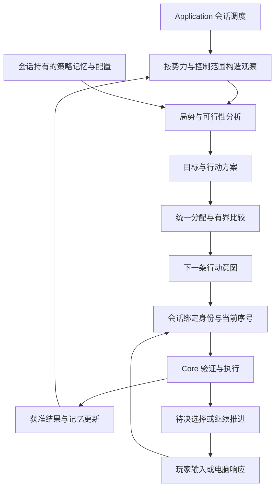

# 游戏 AI 系统设计

- 状态：已确认（基础改造已接入；完整 AI 尚未交付）
- 日期：2026-10-11
- 范围：电脑势力自主运行、既有自动军团的权限接入、日内响应、保存与评测
- 性质：基于当前重制规则的自主设计，不复刻原版 AI 算法

## 目标与系统边界

游戏 AI 同时服务于电脑势力和玩家委任军团：电脑势力管理全势力，玩家委任军团只在获准的对象、账户和方针范围内行动。两者使用同一套规划能力，在与玩家相同的玩法规则下维持生存、发展实力、组织战争，并对局势变化作出连贯调整。它输出合法行动和必要的事件选择，领域引擎决定这些行动能否成立以及产生什么结果。

设计以三个问题为起点：当前必须保住什么，有限资源应投向哪里，已经开始的行动如何完成或退出。由此采用“局势分析、目标与方案、统一分配、执行反馈”的结构。旬级决策安排经营与战役，日内响应处理明确的选择，部队移动和战斗仍由公共规则逐日执行。

首版交付一个可解释、可复现的标准策略，覆盖经营、人事、军事、外交和事件。必须能够完成经营、补员、集结、占领和巩固的完整过程，也能在无胜算时减损；不以每旬都出征、命令数量多或单一胜率高作为智能程度。

最终能力目标是：在相同玩法规则、信息权限和可比开局条件下，最高能力档通过决策水平强过大多数熟悉本作规则的老玩家。首版可玩和 G11／G12 的工程验收是中间里程碑，不是这个目标的完成证明。达标须由独立对抗评测确认，不能仅凭算法名称、自动对局胜率或设计意图宣称。

首版不引入在线大模型、训练管线、全局博弈树、战争迷雾新玩法或新委任菜单。可选委任方针的产品设计独立安排，当前已有控制权限和方针限制继续生效。长期全地图对局仍归路线图 G12，不能由局部策略测试代替。

本文是自主 AI 接入的唯一权威计划，集中维护系统设计、实施顺序和完成条件。BEH／DEC 分别维护具体行为与长期取舍，不另行维护一套实施路线；当前已实现行为与接入后的目标行为分开标明。

## 当前代码提供了什么

| 当前入口 | 可复用基础 | 正式接入需解决的问题 |
| --- | --- | --- |
| [AiPlanning.cs](../src/San9.Application/AI/AiPlanning.cs)与[DomesticObservation.cs](../src/San9.Application/AI/DomesticObservation.cs) | 分析随机和预算；经营已具备权限裁剪的不可变观察与纯候选生成 | 尚无全领域观察、持久策略记忆或配置输入；现有经营阈值仍属阶段策略 |
| [AutomaticTurnRunner.cs](../src/San9.Application/AI/AutomaticTurnRunner.cs) | 会话统一执行自动工作与结束控制，电脑直属经营和委任调度接通，电脑根军团不重复调度 | 仍按领域顺序选少量命令，尚无共同目标和跨领域分配 |
| [GameSession.cs](../src/San9.Application/GameSession.cs) | 候选世界、验证、事件聚合和成功发布 | 策略状态必须一起分叉、发布、回滚；不同推进入口须调用同一自动调度 |
| [SimulationEngine.cs](../src/San9.Core/Simulation/SimulationEngine.cs)与[ResolutionPipeline.cs](../src/San9.Core/Simulation/ResolutionPipeline.cs) | 公共命令及暂停续行 | 部分响应授权只接受玩家，另有 Core 内直接做出的电脑选择，需要按语义拆分 |
| [EconomicOutlook.cs](../src/San9.Core/Simulation/Economy/EconomicOutlook.cs) | 按账户估算收入、薪俸和粮耗 | 静态预测不等于未来行动预算，需要计入新方案与在途任务 |
| [MilitaryArrivalForecast.cs](../src/San9.Core/Simulation/Movement/MilitaryArrivalForecast.cs) | 复用移动规则的到达估计，区分不可达与未完成 | 当前直接接收完整世界；AI 使用前须收窄输入并接入统一工作计量 |
| [SessionProtocol.cs](../src/San9.Application/SessionProtocol.cs)与[SaveService.cs](../src/San9.Application/Persistence/SaveService.cs) | 会话状态、精确恢复、玩家读档与录像基础 | 增加策略记忆和配置身份；不能只验证世界摘要 |
| [HeadlessHost.cs](../src/San9.Headless/HeadlessHost.cs) | 独立进程运行与恢复对照；脚本只为玩家席位下令，电脑使用会话自动调度 | 仍需增加完整 AI 的行为与工作量报告 |

以上是接入起点，不代表隔离、完整响应或自主经营已经实现。当前有限策略可用于旧能力的对照测试，不作为新系统内部继续叠加的骨架。

当前基础改造覆盖经营观察、确定性候选工作计量、意图与提交分离、统一结束控制和 CLI 席位分工。没有新增空策略记忆、人格或搜索接口，也没有改变保存结构；自动调度行为变化更新规则版本。AI-01 的跨旬目标、持久化和统一资源账本，以及 AI-02 的电脑响应仍未完成。

## 必须保持的不变量

1. Core 独占世界状态、资格、成本、耗时、随机效果和结算；AI 不能直接修改人物、兵力、账户或关系。
2. 一个对象在一次分配中只有一个主要用途；资源以实际账户计量，不能借势力总额跨军团透支。
3. 看得到不等于可以控制。玩家直属范围不能被 AI 调用、预留或改方针。
4. 相同获准信息、记忆、配置、运行种子和工作预算产生相同决策；机器速度、缓存温度和诊断级别不改变结果。
5. 策略记忆与世界属于同一次会话提交；拒绝的外层操作不能留下半份计划或已消费的权威状态。
6. 电脑必须回答自己负责的待决选择；玩家选择必须保留给玩家。推进不能依赖 Godot 界面存在。
7. 长期目标是可撤销的承诺，不是世界资源锁；每次执行重新验证当前事实。
8. 难度改变决策能力和取舍，不暗改资源、效果或信息权限。明确存在的玩法例外按对应规格单独验收。

## 架构与状态所有权

规划代码先留在 `San9.Application.AI`，不增加独立服务或工程。内部按观察、分析、方案、分配、响应和诊断组织，具体文件随真实职责产生。Godot 和 Headless 只发起会话操作，不拥有另一套 AI；Content 保存通用玩法定义，Importer 只负责源格式转换。

| 数据 | 所有者 | 保存与失效 |
| --- | --- | --- |
| 当前世界、控制权、已签发任务 | Core | 使用既有领域保存规则 |
| 活跃目标、战役阶段、跨旬承诺、失败冷却、等待年龄 | Application 会话 | 凡影响未来选择均保存，进入会话摘要；失效按对象和控制范围清理 |
| 策略版本、难度配置、实际参数值 | Application 会话 | 保存可复现的配置值及身份，不依赖读档机器上的可变默认值 |
| 候选、当前批次预留、路线与收支分析 | 单次规划 | 可重建，不保存；缓存键覆盖实际输入依赖 |
| 解释、被淘汰方案、耗时统计 | 诊断输出 | 不进入状态摘要或普通存档，按容量限制保留 |

策略记忆只保留无法从当前世界还原的意图。不能把整份城市资源、人物名单或所有历史命令复制进去。已完成目标移出活跃集合，过期冷却删除；存储量随当前目标和对象规模增长，不随游戏旬数持续增长。

### 决策协议

建议用以下逻辑契约统一现有协议，名称可随实现调整，但数据方向固定：

| 契约 | 必要内容 |
| --- | --- |
| `AiDecisionInput` | 获准观察、控制范围、不可变策略记忆、策略配置、决策用途、剩余工作额度 |
| `AiDecisionResult` | 一条待提交意图或停止原因、关联方案、确定性工作消耗、记忆变更建议、可选解释 |
| `AiActionIntent` | 公共命令语义所需参数、执行权限范围、预期前置条件；不预分配正式序号 |
| `AiExecutionFeedback` | 接受／拒绝、获准效果、关联任务或部队身份、当前边界；不把完整内部事件直接喂回规划器 |
| `AiDecisionPrompt` | 待决身份、响应者、选择类型、获准载荷与合法选项／参数约束 |

规划器无会话、引擎或完整世界引用，也不持有能绕回完整快照的查询回调。纯分析可以组合多个方案，但每次只提交一条当前可执行意图。Application 生成命令身份、绑定最新序号和控制者，经公共 `Execute` 执行，再以结果更新记忆。

目标建立或放弃可能不立即产生领域命令，这类记忆变化在成功的外层会话操作内提交；与出征、调动等绑定的承诺只有在对应命令成功后才记为已执行。拒绝只能记录获准原因与必要冷却，不能把失败命令当作已有部队或在途支援。

## 观察与信息权限

观察由 Application 在明确的势力视角下构造，不复用带完整 `World` 引用的表现层对象。公共资格和估算公式可以下沉或提取为只读规则，但 AI 可访问的查询参数、返回值及拒绝信息同样受视角约束。

下面是首版采用的权限矩阵。它沿用当前公开信息和显示限制，不新增地图迷雾；具体字段随消费能力落地。当前实现的参考位置为[战略投影](../src/San9.Application/Presentation/StrategySnapshot.cs)、[部队详情](../src/San9.Application/Presentation/UnitDetails.cs)和[命令显示](../src/San9.Application/Presentation/OfficerCommands.cs)。

| 信息 | 本方 | 其他势力 | 处理要求 |
| --- | --- | --- | --- |
| 日期、地图拓扑、通用规则、已启用内容 | 可读 | 公共 | 不包含未启用对象或源槽位 |
| 公开势力、据点归属与已公开人物 | 可读 | 按现有公开查询 | 隐藏／未登场人物不提前进入候选 |
| 据点兵力、士气、耐久和公开资源信息 | 完整 | 只投影玩家同条件可查询字段 | 不因内部存在更多字段就扩大权限 |
| 地图可见部队的位置、兵力、阵型与成员 | 完整 | 按公共列表与详情 | 隐匿等领域状态遵从同一可见规则 |
| 部队命令、目标和已装备兵法 | 完整 | 分别受命令、兵法可见设置限制 | 首版对各观察势力采用同一设置语义，实施时同步可见性规格 |
| 部队自主策略、未公开任务载荷 | 完整 | 不可读 | 敌方行为由公开状态估计，不能读取其真实计划 |
| 本方任务、归期、权限与账户归属 | 可读 | 仅公开部分 | 在途资源与立即可用资源分开；军团行动权限另列 |
| 待决选项与谈判内容 | 响应者可读 | 只读已公开结果 | 不泄漏其他响应者的私有选项与报价依据 |
| 正式随机状态、预抽任务骰子、隐藏触发条件、其他 AI 记忆 | 不可读 | 不可读 | 自己的任务也不暴露未来随机结果 |

未知值、未适用值和零值必须分开。位置或兵力未知时采用明确假设区间，说明风险；不能伪造精确预测。相同获准观察下改变隐藏世界，计划与分析随机应保持一致。

现有到达预测和经济预测不能仅包一层接口就交给规划器。先核对实际依赖，将必要通用计算改成只消费明确输入的共享规则；AI 用获准数据构造估算，Core 执行仍使用权威数据。路线搜索不得通过隐藏占位、真实敌军命令或验证拒绝成为探测接口。

## 从局势到行动的算法

### 时间和资源的统一表示

所有候选都以领域日期表达出发、到达、完成和资源释放时间。分析窗口覆盖下一次可靠收入／收获、主要敌军可能接敌时间和本方方案完成时间；不假定每项工作都在下一旬完成。

资金和粮食按账户预测，兵力按驻地和在途归属计量，人物按资格和可再次行动日期分配。一个资源项至少区分当前可用、已被领域任务占用、预计到达和本次计划预留。预计收入或援军不能用于当前立即支付；未来不确定收入按风险估计，不作已到账资源。

可用兵力从现有兵力中扣除已执行调动、留守需求和其他已选方案承诺。不能先对所有城市各算一次“可出兵”，再重复加到多个战线。行政军团是权限和账户边界，攻防方向是分析分组，二者不要求一致。

### 局势分析

每轮先形成四类可复用结果：

- **生存压力**：资金／粮食能维持多久，哪座据点可能在何时失守，哪些关键人员存在流失风险。
- **行动能力**：各地可调人员与兵力、合法阵型兵法、到达时间、补充和撤回条件。
- **发展机会**：内政投入的边际收益、人员缺口、外交缓冲和具有实际价值的进攻窗口。
- **现有承诺**：已经派出的力量、在途补给、目标进展及导致继续／缩减／终止的变化。

威胁按目标与时间窗口累计可到达力量，区分当前接敌、近期增援和远期潜力。敌方同一支力量不能在一个联合假设中同时出现在多个地点。对主攻、固守、增援或反击构造少量可行反应，避免把所有敌军的最坏情况同时叠加成永远不敢进攻的判断。

战力估算使用共同的属性、地形、射程、阵型与伤害规则，但不复制一套独立结算器。先算静态能力和可持续作战时间，再对关键方案做有限前瞻。前瞻只使用合法观察构建的局面，不能复制隐藏世界后声称只看公开结果。

### 目标和方案

目标描述想要改变的世界条件，例如“在敌军到达前保住据点”“恢复可供养的兵力”“取得并守住某城”。方案描述达成目标的一组动作。目标不直接绑定唯一实施方法：缺粮可以购粮、合法输送、缩减计划或撤回部队，分别比较时效和代价。

一个方案包括目标、阶段、参与对象、按账户和日期分解的资源需求、行动依赖、预期效果、风险、继续条件与退出办法。共同行动必须显式表达互补关系，例如两队合击、先调将再出征、先筹粮再扩军；不能把每条命令独立打分后认为总分最高就是可行方案。

候选从具体需求生成：缺口触发补给或招募，威胁触发救援或减损，剩余能力触发发展和进攻。不每旬穷举所有人物与所有命令的笛卡尔积。筛选保留不同优势：快到、低成本、强攻、低风险和保留后手；编号只用于最终平局，不用于截掉所有后编号对象。

### 选择和分配

首版采用确定性分层比较与有界局部改善，不要求求出全局最优：

1. 排除权限、立即支付、对象唯一占用和命令资格不成立的方案。估算不完整的方案不能被当成确定可行。
2. 优先处理有明确截止时间的生存威胁，比较可救程度和损失；全部无法满足时选择合法减损，不因“必须全守住”而无解。
3. 将现有有效承诺与新方案一起分配。新方案要扣除放弃原行动的损失和转向成本，紧急威胁可以覆盖持续性偏好。
4. 对发展与扩张方案比较净价值，在冲突预算内做替换、交换和少量组合搜索，直到额度用尽或不能改善。
5. 从入选方案中取前置条件已满足的下一条意图；提交后修订分配，再决定下一条。

资源账本只有一份批次预留，方案失败、缩小或成功消耗后立即更新。必须先联合分配再确定具体编队，避免第一支部队拿走全部优秀人员。人物的机会成本包括原岗位收益、行程和行动占用，而不只是能力值高低。

经济类收益先转成明确时间窗内的资源增量；战役类收益估算控制、通道、后续威胁与损失，再通过版本化评价参数映射为比较值。不同优先层不直接相加，跨领域映射属于策略参数，不冒充领域公式。分数拆成收益、资源成本、占用成本、风险和转向成本，方便用反例定位偏差。

### 跨旬持续与重规划

战役按“准备、集结、执行、巩固、退出”组织。只有入选并需要跨旬持续的方案进入记忆，小额当旬内政不建立长期项目。每阶段都定义完成条件与进展量：准备缺口减少、预计会合时间改善、有效距离减少、目标兵力削弱或占领稳定。

重规划发生在自己的合法下令边界，或领域已经提供的响应边界。据点易主、外交保护、主将离队、路线失败和严重损失令对应方案失效；这不赋予 AI 在日内任意重发军令的权限。日内自主撤退等能力仍通过双方共享的部队策略执行。

普通转向要求收益足以覆盖转换成本，连续无进展按阶段和实际行程判断。失败冷却关联目标、失败类型和相关条件；条件已变化时允许重试，不能固定封禁有效目标。所有目标都不可行时明确等待并保留原因，不构造无意义任务。

## 领域能力与命令覆盖

以下以当前 [GameCommand](../src/San9.Core/Simulation/GameCommand.cs) 注册的命令语义为起点。自主选择表示首版需要评估该能力，不要求每轮使用；响应命令只在对应待决状态下产生。内部任务和全局禁用命令不进入候选。后续新增公共命令必须明确落入哪类，而不是默认 AI 自动获得支持。

| 能力 | 公共命令 | 选择依据与边界 |
| --- | --- | --- |
| 内政、征兵、训练、修复 | `DevelopCommand` | 比较活动的实际增益与占用；征兵受兵源、军事需求和可供养能力约束 |
| 粮食买卖 | `FoodTradeCommand` | 优先解决可解的账户缺口，计入商人条件、价格和未来消耗，不无目的来回交易 |
| 人员补充与配置 | `SearchCommand`、`RecruitOfficerCommand`、`MoveOfficersCommand` | 先识别岗位缺口，再比较成功预期、行程及原岗位损失，不硬编码人物名单 |
| 忠诚、官职、军师与宝物 | `RewardOfficerCommand`、`AssignOfficesCommand`、`AppointAdviserCommand`、`GrantTreasureCommand`、`ConfiscateTreasureCommand` | 忠诚风险与实际规则收益进入共同预算；褒美无电脑专属开局等待或编号窗口，不反复改任和转交 |
| 俘虏和人员处置 | `ReleasePrisonerCommand`、`ExecutePrisonerCommand`、`ExileOfficerCommand` | 比较招募、关系和人员损失；破坏性选择需要明确收益，不用低能力排名机械驱逐 |
| 部队投送 | `DeployUnitCommand`、`TransportUnitCommand` | 共同选择人员、兵力、阵型、出发地与时机，检验到达、粮耗、留守和接收能力 |
| 部队控制 | `OrderUnitCommand`、`SetUnitPoliciesCommand`、`SelectTacticCommand` | 围绕任务选择军令、兵法和自动策略；仅在公共资格允许的时机改变 |
| 设施 | `ConstructFacilityCommand`、`DemolishFacilityCommand` | 评估实际阻挡、支援或通道价值，扣除建造时间、费用和拆除损失 |
| 外交 | `GiftCommand`、`RequestAttackCommand`、`DemandSurrenderCommand`、`ReturnPrisonerCommand` | 服务于缓和战线、协同、取回人员或扩张；使者、货物和谈判成本与军事经营竞争 |
| 计略 | `BurnCommand`、`AlienateCommand`、`SeizeCommand`、`GossipCommand`、`UnitStrategyCommand` | 评估目标价值、时间、成功预期与机会成本；不读预抽结果，不因合法就执行 |
| 军团治理 | `CreateCorpsCommand`、`ChangeCorpsCommand`、`DissolveCorpsCommand` | 仅在合法授权下按实际战线和账户需求组织，不复制原版城市阈值与按人数机械分账 |
| 控制和委任设置 | `SetCorpsControlCommand`、`SetCorpsDelegationCommand` | 自主势力可在自身治理权限内配置；玩家势力中的 AI 不改玩家授予的权限与方针 |
| 日任务选择 | `RespondDailyTaskCommand` | 按具体搜索、谈判、投资等语义评估载荷与合法参数，不能统一为接受／拒绝 |
| 政治和学习响应 | `AllianceParticipationCommand`、`RespondOfficeRequestCommand`、`RespondEmperorTransferCommand`、`ChooseCountryTitleCommand`、`ChooseTacticStudentCommand` | 只回答本方合法选择，分别按战略、人员和实际规则收益处理 |
| 君主处置和继任响应 | `ChooseCapturedRulerDispositionCommand`、`ChooseSnipingSuccessorCommand`、`ChooseDuelSuccessorCommand`、`ChooseExecutionSuccessorCommand` | 在 Core 提供的合法结果空间内选择；强制规则不改成策略选项 |
| 收尾 | `WaitCommand`及会话结束控制 | 明确无有益动作或预算耗尽；结束控制由调度器执行，不靠重复等待命令制造进展 |
| 排除 | `ReformUnitCommand`、内部 `StartTaskCommand` | 整编全局禁用，不生成、评分或模拟；内部任务由公共命令建立，不直接签发 |

经营首先满足可持续运行，再投入发展。人物不默认按最高能力全部投入一项活动，须计算边际贡献和其余岗位需求。外交、计略与军事读取同一目标状态，关系变化立即使不再合法的进攻承诺失效。在途使者、调将与补给计入已有投入，避免重复发送。

军事首版包含守备、及时救援、协同进攻、补给、撤回与占领巩固。留守兵力随威胁、地形和援军时间变化。集结用到达窗口与最低有效力量判断，不能以“都已出发”视作完成；攻占之后还要评估治安、守备、粮耗和能否抵御反击。不增加当前玩法不存在的独立补给线或自动瞬移调拨。

玩家势力的自动军团只使用获准控制的对象与账户。同一势力的多个自动范围在一个协调批次中处理，共享资源冲突检查，再分别以合法控制者身份提交；不各自建立一份势力总额预算。跨军团协调只能经双方都受约束的治理或调动命令实现。

## 会话调度与日内选择

### 单一生产入口

会话自动调度负责三件事：执行当前席位的自动工作、结束该席位、在推进暂停时回答电脑待决选择。`EndControlOperation`、`PrepareAdvanceOperation`、`AdvanceOperation` 和 `AdvanceDayOperation` 共用这套调度规则，不能根据从客户端还是 CLI 调用而产生不同决策。

保留当前重制版控制顺序：新局玩家势力在前，其余势力按 ID 排列，按当前控制序列执行；不改成同时规划。即时命令成功后影响后续势力的获准观察，有耗时任务走共同日级推进。接受既有先后手差异，不把同步下令或联机公平性作为此次接入前置。

一次自动控制批次按以下顺序执行：

1. 从候选世界确定本次合法控制范围，清理该范围失效承诺，创建本轮唯一工作账本。
2. 构造观察，分析需求，建立或修订方案，分配资源并提出下一条意图。
3. 绑定当前身份和序号，经公共入口执行。成功则处理获准反馈；拒绝则分类修复或停止该方案。
4. 后续规划沿用剩余预算，根据当前状态刷新必要分析，不重新获得整轮额度。
5. 没有有益合法行动或可选预算耗尽时结束控制；轮到玩家响应则向调用端返回。

调度不新增隐藏的“已经运行过”静态集合，以现有控制进度、正式任务和显式会话状态确定执行边界。分步准备再逐日推进，与直接推进一旬在相同外部操作语义下产生一致结果。脚本玩家仍可向其席位下令，自主席位只由会话自动规划，Headless 不提前再调用一遍策略。

### 电脑响应协议

Core 在规则需要选择时产生待决状态和合法选项，随后退出当前结算调用；Application 判断响应所有者并选择。Core 不在持有可变世界的调用栈内反调 AI，AI 也不通过伪装玩家绕过授权。

需要核对两类现有分支：玩家已经可以选择而电脑直接采用固定答案的分支，以及资格本身按控制者区别处理的分支。前者将策略选择移至 Application；后者先区分设计上的辅助／例外与技术性玩家门，再同步对应行为规格。不能把所有 `Player` 条件机械删除，例如[修习报名](../src/San9.Core/Simulation/Personnel/TacticStudy.cs)还涉及城市和军团资格。

响应授权检查待决身份、当前阶段、响应势力及合法控制者，不要求该势力恰好是旬级活动席位。势力级政治和继任选择归势力控制者；任务／军团级选择按该任务的合法控制范围归属，不能仅因处于玩家势力就全部弹给玩家。首个贯通场景选择[被俘君主处置](../src/San9.Core/Simulation/Personnel/CapturedRulerDisposition.cs)，同时覆盖释放、处决及可能产生的继任续行。

响应类型使用专用参数与评价，不强行压成布尔值。资金报价等空间由公共约束确定可行范围，AI 生成有界代表点并保留规则定义的可完成选项。强制领域结果继续自动结算，不人为制造待决状态。

电脑响应采用独立的有界求值额度，战略预算耗尽不影响响应。无法深入比较时按该类型明示的默认偏好选择合法选项；默认偏好只降低决策质量，不能跳过选择或修改资格。每次响应必须推进任务步骤、消除当前选择或进入新的有效选择；同一待决身份与阶段重复出现且无进展视为错误，输出可复现故障，不无限循环或伪造成功。

电脑连续响应完成后继续原结算，遇到玩家选择、合法日／旬返回点或终局停止。电脑选择链暂不增加中途存档协议，仍沿用完整旬结算后的稳定保存边界。终局立即结束自动调度，不再生成经营或军事命令。

### 失败与事务

| 情形 | 处理 |
| --- | --- |
| 人物、账户或权限变化 | 删除失效预留，在剩余额度中重新分配 |
| 目标易主、外交保护或引用失效 | 终止对应方案，按合法命令重定向已出发力量 |
| 路线确定不可达 | 比较其他目标或路线，记录有失效条件的冷却 |
| 路线求值未完成 | 记为预算不足，不当作不可达，也不永久排除目标 |
| 某条候选被拒绝 | 不占正式序号；同一状态与参数不无界重试；获准拒绝信息不能用于探测隐藏事实 |
| 已接受第一条、第二条被拒绝 | 保留当前候选事务内第一条结果，调整后续动作；不能凭空退款或收回部队 |
| 外层会话操作失败 | 候选世界、策略记忆、记录与水位一起回滚，不发布半完成结果 |
| 违反不变量、未知响应或规划器异常 | 报告实现故障；不能用通用等待吞掉问题并宣称正常自动运行 |

## 确定性与计算成本

分析随机基于当前运行种子、观察势力、领域日期和命名用途稳定派生，不读取世界摘要或正式随机流。策略和配置是决策输入，随机样本只是估值工具，不提供未来结算结果。对象遍历、平局比较、整数运算和集合输出顺序明确固定；首版不引入并发搜索。

工作预算分为候选构造、路线展开、方案求值、局部改善、可选推演和提交尝试。不是只在最外层计一次 `Plan` 调用：大循环、路径节点和模拟步都必须有界。创建观察的必要线性扫描单独计量，不能以低预算截掉部分世界后假装信息完整；搜索额度可以按获准对象规模确定性增长。

各类工作设总额度与子额度，子任务不得自行创建无限预算。缓存命中仍按相同逻辑工作量扣费，缓存只减少物理时间。重规划共享本轮余额，响应使用独立保留额度。停止原因至少区分无需求、无合法方案、收益不足、预算耗尽和规则故障。

低预算优先完成生存判断与已有承诺维护，再扩展普通机会；效用相近时使用等待年龄抑制长期饥饿，最终用稳定身份消除平局。增加预算扩大候选覆盖、组合改善或前瞻，不仅重复计算原候选。具体额度由公开场景和全地图测量定标，不在设计阶段任意承诺毫秒或节点常数。

性能报告同时保留逻辑工作量与墙钟耗时，并注明机器、内容规模、策略版本和配置。耗时用于诊断及性能门槛，不决定权威搜索何时结束。缓存或增量分析只在测量证明必要后加入，键包括观察依赖、规则和配置，冷／暖缓存及恢复后的空缓存决策必须一致。

## 保存恢复与策略生命周期

`SessionSnapshot` 增加 AI 状态和版本化配置，会话摘要包含它们，Core 世界摘要不承担 Application 状态。捕获缓存不能只看世界引用：即便世界未变，目标或配置变化也必须失效。普通存档继续允许合法手工修改，不重新加入存档完整性哈希；载入验证字段、范围、身份引用与状态不变量。

| 操作 | AI 状态处理 |
| --- | --- |
| 新局或动态创建势力 | 初始化对应控制范围的空承诺和确定配置，首次合法边界开始规划 |
| 精确恢复 | 保留记忆、配置和运行种子，后续命令及会话摘要与连续运行一致 |
| 玩家读档 | 沿用现有更换运行种子的规则，保留目标与有效承诺；允许抽样变化，不重置战役 |
| 玩家接回一个军团 | 只清理该范围自动承诺和预留，其他军团计划保留；已签发任务按领域规则继续 |
| 转为电脑控制 | 从当前真实状态建立计划，不恢复已撤销旧命令 |
| 军团合并／解散、人员转属、据点易主 | 按当前归属修订或撤销受影响承诺，不复制旧账户或重复计入对象 |
| 势力灭亡与终局 | 移除失效活跃计划，终止自动工作 |

影响后续决策的跨稳定边界游标、冷却和等待年龄都属于记忆，不能藏在规划器实例。瞬时预算账本和分析缓存不保存，因为本设计不在自动批次内部提供保存边界。游戏显示诊断不需要保存完整候选历史。

协议结构变更按既有严格格式版本处理，不把旧档缺失的 AI 状态默认为空后悄悄续跑。策略算法版本纳入规则身份并单独可追溯；沿用当前规则版本差异告警机制，不承诺不同算法版本的精确重放。配置数据结构不支持时明确拒绝，不保留旧规划器作兼容执行路径。

录像保留外部会话操作，由同一会话确定性再生自动命令与电脑响应，并核验事件和最终会话摘要。内部 AI 命令不同时作为独立外部请求重放，防止执行两次。发生差异时诊断记录第一个自动决策边界、输入身份和选择；本次不建设跨策略版本的结果录像播放器。

## 诊断、难度与可扩展性

每次决策的最小解释包括：要解决的需求、选中目标、使用的账户／人员、预计完成时间、主要风险、淘汰备选的关键原因和停止原因。详细诊断可记录分项评分，但只能解释已计费的计算，不能为了生成解释额外搜索并改变随机状态。

诊断分为自动测试可读的稳定原因码和便于人读的文字，不以中文文本作为程序判断依据。开发日志可以包含调试数据，面向玩家显示时必须再次按信息权限裁剪，不能泄漏敌方未公开计划。首版先接 Headless 报告，不为诊断强制新增客户端菜单。

先固定一个标准策略建立基线，再形成预算与策略参数不同的难度档位。低档仍能生存和合法续行，高档通过更好的候选、协调、估值或前瞻获得优势。对每档保存实际参数，不仅保存名称；难度切换若以后开放，应是可记录的显式会话操作，首版不增加该菜单。

电脑专属的额外士兵、金粮补发、收入倍率、维护减免、战斗或成功率加成、隐藏情报及预知随机结果，均不得用于实现难度提升或最高能力目标。剧本原有势力差异与明确玩法特性可以保留，但不能把有利开局或针对玩家的电脑合谋计作决策优势；高水平评测须控制这些因素。

人格与难度独立，势力差异共用同一套强决策能力，具体设计见下节。Mod 的对象、地图和规则规模不能被固定编号、人物榜单、城市数量或原版槽位限制；缺少合法玩法能力时明确报告，不能越过内容契约补造资源或指令。

### 共享能力与势力风格

不同势力应具有可辨识的决策风格。以持续增强的统一 AI 为基础，通过显式偏好影响目标价值、方案评价与承诺持续性，不为每个势力另写规划器、独立算法或按势力 ID 分支的脚本。威胁评估、战力投送、编队、搜索、推演、权限和执行机制共用，能力改进可以惠及所有风格。

| 因素 | 决定什么 | 与其他因素的边界 |
| --- | --- | --- |
| 难度与能力配置 | 候选覆盖、估值精度、搜索与推演深度、确定性工作预算 | 回答“能判断得多好”，不决定势力必须好战或保守 |
| 势力风格 | 扩张节奏、风险容忍、预备偏好、长期投资、外交合作及承诺倾向 | 回答“在合理方案间偏好什么”，不改变规则、情报或资源 |
| 当前处境 | 实力、地理、敌情、收支、关系与已经执行的任务 | 决定哪些方案实际可行；同一风格在强弱势下应采取不同策略 |
| 委任方针与控制权限 | 允许操作的对象、账户、目标和行为范围 | 属于硬边界，风格不能改写玩家方针或接管直属军团 |

风格维度采用少量有明确行为含义的参数，例如更偏好集中决战还是保留预备、更早扩张还是先提高供养能力、更重视外交缓冲还是独立作战。使用连续偏好形成组合，不把所有势力锁进几个互斥职业；具体参数随真实策略消费者落地，不先堆出大量无效果标签。

风格必须参与目标和方案比较，而不只在最后随机换一条命令；候选生成仍保留必要的替代方案，不能让偏好过早裁掉救命动作。进取型也要检查粮草和退路，谨慎型也应把握明确的低风险收益，合作型不能无条件送礼。资格、信息权限和基本生存要求先于风格，败局中的合理冒险仍由实际可救程度判断。

采用强能力底座不意味着每种风格都必然等强。偏好改变可能牺牲部分纯胜率，因此在同难度、同预算、可比开局下分别测量行为差异、能力下限和可利用弱点，必要时收窄参数范围。最高能力档的每个正式风格都需接受强度评测，不能把统一基线的胜绩直接算给所有变体；默认体验可以在明确定位下提供更鲜明的风格。

风格来源使用 Content 中作者可配置的语义定义与引用，可由剧本指定；未指定时采用明确的中性默认配置，不按原版势力编号猜测。首个风格版本采用稳定的势力级配置，君主继任不自动换人格；以后若引入君主、都督个性，应显式定义组合优先级与切换时机，不能让一次人物变动无条件推翻正在进行的战役。玩家委任军团先服从方针，再在合法方案间表达风格。

实际风格参数与版本纳入已有策略配置的保存和会话摘要；局势适应由当前观察与显式记忆推导，不另藏可变状态。若以后需要随机生成风格，只在定义好的初始化边界用独立确定性随机生成并保存，不每旬重抽或因普通读档改换性格。

实施上先使中性策略具备可靠的共同分析与分配能力，再接少量对比鲜明的风格，以相同局势测试扩张、预备和外交选择的差异；无需等待最强档全部完成，后续随能力升级共同复验。验收还须证明风格在紧急处境下能合理调整、长期可辨识但不机械重复，且无法被一种固定诱导稳定利用。人格只增加配置和评价差异，不建立第二套生产 AI。

### 能力递进与最终强度

以下层次描述研发能力，不直接对应玩家难度菜单。电脑势力和玩家委任军团共用能力，后者始终受授权范围与方针限制；单个军团不会因此获得全势力控制权。

| 层次 | 重点能力 | 进入下一层的证据 |
| --- | --- | --- |
| 第一层 完整自主运行 | 生存经营、人员调动、合法编队、基本威胁与战力投送、全领域命令和响应、持续目标 | G11 完整闭环通过；G12 长期运行稳定，无系统性停滞、透支或权限漏洞 |
| 第二层 协同与方案优化 | 多方向资源协调、留守与预备、跨城集结、武将／阵型／兵法联合搜索，计入到达时间、后勤和机会成本 | 在固定与未参与调参的场景中，相对第一层减少错配和无效损失，提高及时救援、合力进攻与巩固能力 |
| 第三层 对抗前瞻 | 有界兵棋推演，比较对手固守、增援、反击等反应；结合意图假设和不确定性，比较多步行动与退出方案 | 相对第二层的模块对照有可重复收益，能处理诱敌、牵制、反击窗口及多线压力，不只战胜自身策略 |
| 第四层 老玩家水平对抗 | 将前述能力整合到完整对局，针对真实对手暴露的弱点改善评估、候选与搜索，在未见局势中保持有效 | 按下文老玩家对抗协议证明强过评测人群中的多数，且没有依赖数值优待、信息越权或规则缺陷 |

第二层和第三层的基础能力从 G11 开始接入，表中层次表示深化程度，不要求等前一层全部结束才探索下一层。高水平对抗是明确的后续交付目标，不以“首版够用”取消；具体工程任务由上一层的失败场景和性能结果拆出，继续维护在本文，不另立竞争计划。

威胁评估、战力投送和协同规划是必需能力；兵棋推演逐步从少量关键方案扩展到多步对抗。具体搜索算法可替换，昂贵模块须证明收益；若现有方法达不到最终目标，应改进方法，不降低目标或补发资源。学习与自我对弈是可选技术路线，不是先验必需条件。

最高能力档与默认体验分开：默认档可以按玩家经验提供适宜挑战，最高档保留经验证的决策能力。降低难度也通过规划预算、候选质量与风险取舍实现，不要求玩家必须面对最强策略。

### 搜索和训练的后续空间

保留利用更多计算提高决策能力的方向：启发式给搜索顺序和初始评价，不能把经验阈值固化成无法探索的策略边界。增加搜索只有在固定条件和未参与调参的场景中产生收益才保留；没有收益时先查候选遗漏、评估偏差和重复工作。

游戏规则和模拟吞吐稳定后，可以研究自我对弈、策略／价值学习和搜索结合。此前关于《The Bitter Lesson》及 AlphaGo Master／AlphaGo Zero 的启发保留为研究方向，不把它们当成当前算法、相同训练流程或性能承诺，也不为训练预建接口。

研究须考虑多势力互动、长时程回报、动作组合及信息权限，使用固定基线、历史版本和不同对手验证泛化，并区分有效策略、规则漏洞和奖励投机。训练模型、配置与评测数据需要版本化；推理确定性和保存重放届时另行设计。科研价值可以是发现盲点和形成可复现实验，不等于产品默认对手必须最强；挑战性、可理解性和玩家成长空间分别评估。

## 实施顺序与阶段出口

以下是 G11 内部施工顺序，使用独立标识，不改变路线图 G11／G12 的整体职责。每一步必须交付可运行行为与对应测试，不先提交成批空接口。

| 步骤 | 交付 | 出口 |
| --- | --- | --- |
| AI-01 会话纵向闭环 | 最小真实观察、权限投影、统一调度、工作账本、策略状态保存；用真实缺粮处理和跨旬恢复目标贯通 | 新入口完成合法经营；恢复、事务回滚、信息隔离、入口去重通过；使用到的旧经营路径退出该范围 |
| AI-02 响应纵向闭环 | 被俘君主处置及继任续行接入响应所有权、合法选项和公共提交 | 电脑释放／处决后能继续推进，玩家仍等待输入；战略额度耗尽不挂起；未知响应明确失败 |
| AI-03 经营与共同分配 | 账户预测、人员供给、岗位机会成本、基本威胁与到达分析；购粮、内政、人事、救援竞争同一预算 | 可解缺粮得到解决，能及时支援的局面作出有效行动，不能到达时不盲目抽空后方；多账户、多军团无重复占用 |
| AI-04 战役闭环 | 多城力量分配、出发与到达协调、阵型兵法组合、进攻、补给、巩固、撤回和失效修复 | 完成经营到占领闭环；面对迟到、反击、易主、结盟和无进展有实际应对 |
| AI-05 全领域贯通 | 外交、计略、治理、其余日任务和政治人事响应进入同一目标与分配体系 | 命令表逐项有采用策略或排除理由，全部支持的电脑响应无需 UI，既有委任限制与玩家权限保持 |
| AI-06 生产切换与能力定标 | 清除退出生产的旧策略、整理测试基线、难度和报告，190 年完整内容及独立进程验收 | 唯一生产入口，完成场景对照、自动对局、保存与录像核验，登记性能、能力局限和 G12 输入 |

AI-01 的恢复目标需要真实跨旬状态，例如持续检查粮食保障缺口，直到满足可靠收入前的供养条件，而不是为了验证存档保存一个无用计数器。AI-02 尽早验证最难的推进边界，避免直到全领域完成才发现 Core 不能接受电脑答复。AI-03 先在小局面共用基本态势，不要求先完成完整战役搜索。

迁移以“控制范围 × 行为类别”为切换单位，每项明确唯一生产执行者。尚未迁移的有限行为可以暂走原入口，但不得与新入口在同一范围重复执行，迁移表在实现时维护。最终旧策略若有基线价值，移到测试侧保留；产品中不留兼容开关或第二套长期调度。

## 验收设计

### 场景与可观察结果

公开夹具先定义局势、合法可行解、时间窗口和失败条件，再实现策略。下面是必须覆盖的场景主题，不是已经通过的测试。具体数值由该地图行程和规则计算，不能在看到 AI 输出后移动阈值。

| 场景 | 验收结果与对照 |
| --- | --- |
| 收获前缺粮但可购粮 | 在首次断粮前形成足够保障；资金、商人或人物条件不足的对照局面不能生成非法补救 |
| 同一名将竞争内政、外交与救援 | 紧急窗口下优先可救目标，安全时考虑发展；不会一人三用或把在途人物再次当作可用 |
| 多军团一富一穷 | 贫困账户不能花富裕账户的钱；只有合法治理／调运能改变可行性，玩家直属资源不被侵占 |
| 相同距离但不同地形与到达时间 | 能及时到达时支援，必定迟到时改用其他合法方案或减损；不以直线距离等同可达性 |
| 两城合击与不同到达窗口 | 在目标窗口形成必要合力，保持源城可接受风险；不只检查生成两条出征命令 |
| 攻占后的反击与粮耗 | 占领后具有可维持的守备或明确撤出安排，不能只靠短暂易主计作成功 |
| 目标易主、结盟、人员离队、道路失效 | 在下一个合法决策边界修订计划，不无限重试、不反复改令、不保留失效引用 |
| 长途行军与真正停滞 | 正常行程不被误判卡住；实际缺口长期不变时有缩减、换目标或退出 |
| 外交与计略机会 | 选择体现收益和代价，避免重复请求；机会消失后资源转向其他目标 |
| 连续电脑选择中夹有玩家选择 | 电脑合法续行，玩家处准确暂停；不重复日结算、不抢答、不因战略预算耗尽停住 |
| 低预算与多对象 | 逻辑工作有界，生存判断完整，普通任务不长期只服务小编号对象；未完成搜索不等于不可达 |
| 控制切换、动态势力和军团变化 | 只清理失效范围；不删除无关计划、不恢复撤销的承诺、不重复计算账户 |
| 褒美规则一致性 | 开局与原版周期窗口外仍能产生合法候选；缺钱、不合格或本旬已奖励由公共入口拒绝 |

规则平等用相同世界交换控制者验证资格、成本、耗时和效果，已有明确例外另列。新增策略能力使用简单确定性基线；旧有限策略只对照其本来支持的场景，不要求它完成从未实现的能力。

### 协议与长期运行

确定性验证覆盖：相同完整输入同计划、诊断开关、冷暖缓存、改变隐藏世界、不同机器执行顺序风险，以及精确恢复后命令／事件／会话摘要一致。玩家读档更换种子的路径单独验证，不能错误要求与精确恢复相同。

事务测试同时观察世界、策略记忆、记录和水位；至少覆盖命令中途拒绝、外层操作回滚、重复请求、自动响应链和记忆变更但世界未变的捕获。分步推进与整旬推进、客户端会话与 Headless 入口做相同输入的结果对照。

从 AI-01 起运行短程自动对局，用固定脚本、标准策略与不同对手寻找盲点。能力增强保留去掉该分析／搜索的对照，使用未参与调参的场景和种子验证。G11 收口使用 190 年完整内容做阶段集成；G12 再执行固定种子十年或合法提前终局，多势力、恢复与性能压力一起验收。

报告记录完成时间、损失、资源趋势、控制地区、成功／拒绝命令分布、目标切换、无进展旬数、预算耗尽、各类工作量及耗时分布。提高预算须在明确能力指标上有可重复收益，不能只用胜率或命令数量；性能门槛在代表规模实测登记后执行，不以平均耗时掩盖最慢势力。

### 老玩家对抗评测

“强过大多数老玩家”是最终目标，需要独立的人类对抗证据。评测人群应有持续游玩经验，并在正式计分前熟悉重制规则与界面，不能以不熟悉重制差异造成的失误代表水平。按不同玩法风格招募，不能只选开发者、少数熟人或已被用于调参的固定对手。

正式评测前登记玩家资格、样本规模、剧本与势力选择、种子生成方式、换边安排、时间与操作条件、胜负／和局／提前终止规则，以及统计判定方法。AI 版本、配置和实用机器预算固定；评测期间不得针对正在对局的玩家临时调参或读取其隐藏操作。多势力对局还需固定其他席位策略，避免额外电脑无条件围攻玩家。

同一玩家应在多种开局和换边条件下完成多局，兼顾完整对局与典型中残局；记录正常胜负及任务完成、损失和资源效率。最终“多数”按玩家分别汇总对抗成绩后统计，不能让击败少数较弱玩家的大量场次掩盖对多数人的劣势。以预先登记的置信标准判断优势玩家比例是否超过一半；样本不足或不确定区间仍跨过一半时，只能报告尚未证明达标。招募样本存在局限时，结论明确限定评测人群。

完整对局的结果是最终强度证据，局部场景用于解释强弱原因，二者不能互相替代。保留未参与调参的玩家与局势作最终评测，并以历史策略、多种风格对手和不同资源规模检查泛化。规则漏洞或世界不变量异常触发修复与受影响评测重做，不作为高水平能力保留。

### 验证入口

领域计算与响应不变量放在 Core 测试，观察、分配、调度与存档放在 Application 测试，真实 CLI 文件与退出码放在 Headless 测试。共享契约及跨层行为改动运行 `dotnet test San9Remake.slnx`；涉及保存、日志、录像或 CLI 接线还要单独运行 `dotnet test tests/San9.Headless.Tests/San9.Headless.Tests.csproj`，后者不在默认解决方案内。

夹具不依赖私有原版文件；阶段完整包核验与公开单测分别报告。生成报告写入忽略目录 `local/generated/verification/`。算法或文档变化不触发无关内容重转，编译和无界面通过不表示实际画面已验收。

## 规格接入与完成边界

本文维护唯一的设计与阶段计划，相关规格按各步骤的实际行为同步，不能仅新增链接就认为契约已经迁移。

| 权威规格 | 实施时收口内容 |
| --- | --- |
| [AI 行为](behavior/BEH-AI-0001-planning-boundary.md)与[AI 决策](decisions/DEC-AI-0001-deterministic-planning-boundary.md) | 完整决策输入、受限查询、显式记忆、工作计量、结果反馈；保留独立随机与规则平等 |
| [治理与自动调度](behavior/BEH-GOVERNANCE-0002-delegation-control-and-automatic-scheduling.md) | 已去除旧工作表、占位类型与原版分组比例要求；实施时验证权限、需求和守恒，保留已实现控制行为 |
| [自动外交](behavior/BEH-DIPLOMACY-0003-automatic-diplomacy-planning.md) | 已区分公共规则与策略并去除固定顺序和随机跳过门要求；实施时补目标、成本与跨领域分配验收 |
| [保存与录像](behavior/BEH-SAVE-0001-session-persistence-replay-and-headless.md) | 策略状态、配置、原子发布、版本和会话摘要；不改变普通存档可编辑及现有稳定保存边界 |
| [时间推进](behavior/BEH-SIMULATION-0001-time-progression-and-state-visibility.md)及对应事件／人事规格 | 明确待决响应者、电脑授权和续行，逐项区分强制规则、策略选择及已声明玩法例外 |

当前不承诺具体评分权重、工作额度、难度数值或性能数字，这些在对应公开夹具和规模测量中定标；目标、边界和必需能力不等待这些数字即可实施。若暴露出公共命令本身缺少完成目标所必需的能力，先定义玩家同样可用的规则，不在 AI 内私造快捷操作。

完成 AI-01／AI-02 只代表正式链路接通；完成 AI-03／AI-04 代表经营与战争闭环；全领域覆盖、唯一入口与能力对照全部完成才宣告 G11 交付。G12 证明长期运行与稳定性，后续协同优化、对抗前瞻及老玩家对抗按能力层次继续推进；在公平条件下强过大多数老玩家仍是最终能力目标。可选委任产品适配、人格与训练分别安排，不用远期研究替代当前可玩能力，也不把基础阶段通过当作最终强度达标。
