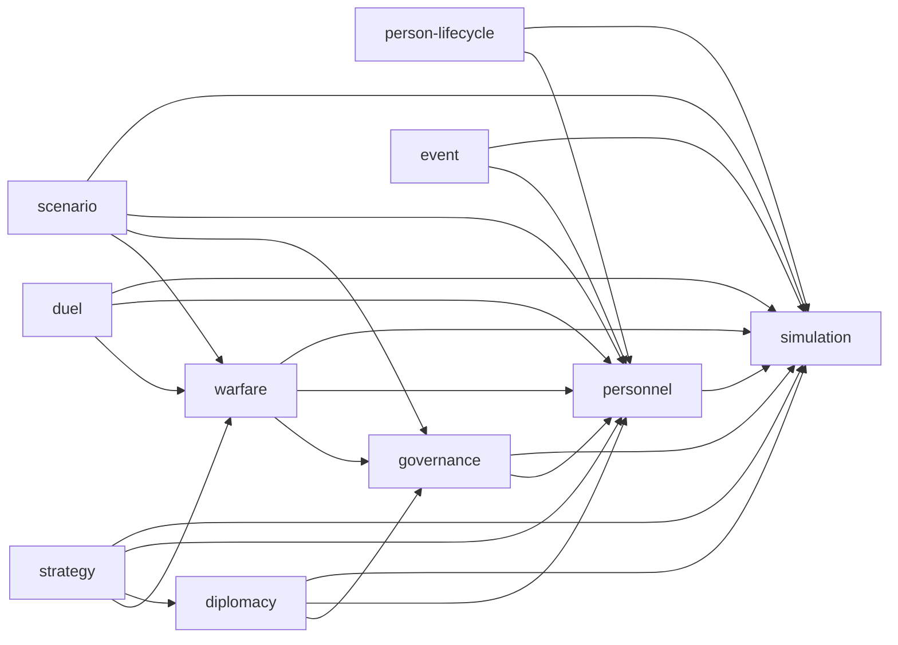

# 核心领域依赖图与实现入口

- 状态：已确认
- 最后更新：2026-08-27
- 机器契约：[core-domain-contracts.json](core-domain-contracts.json)
- 架构决策：[DEC-PROJECT-0001](../decisions/DEC-PROJECT-0001-layered-architecture.md)、[DEC-PROJECT-0002](../decisions/DEC-PROJECT-0002-selective-inheritance.md)、[DEC-SIM-0001](../decisions/DEC-SIM-0001-determinism-and-saves.md)

## 契约边界

本图只聚合状态为“已确认”的行为规格。`objects`、`states`、`inputs`、`outputs`、`invariants` 和验收门是产品实现入口；原版地址、任务码、固定数组、反编译符号和未确认字段不是产品契约。计划路径表示首个实现落点，不表示功能已经完成。

规则只存在于 `San9.Core`。`San9.Application` 组合用例和领域服务；`San9.Content` 提供规范化内容；导入器只在离线转换时运行；Godot 客户端只提交请求并消费只读快照。

## 依赖关系

箭头表示“消费者依赖契约提供者”。依赖图无环；`simulation` 只提供时钟、命令、随机、事务和快照基础，不反向引用具体玩法领域。

推荐实现顺序由该图直接导出：先完成 `simulation`；再完成 `personnel`；随后可并行推进 `person-lifecycle` 与 `governance`；再推进 `warfare` 与 `diplomacy`；之后是 `strategy`、`duel`、`event`；最后以 `scenario` 消费稳定世界快照。并行指开发工作可并行，逻辑提交顺序仍由模拟流水线串行确定。

## 核心领域契约

| 领域 | 已确认规格 | 对象与状态 | 输入 → 输出 | 关键不变量 | 首个实现入口 | 验收条款 |
| --- | --- | --- | --- | --- | --- | ---: |
| `simulation` | `BEH-SIMULATION-0001` | 时钟、周期边界、结算流水线；稳定交互/旬/日/终局短路 | 命令日志、世界与随机状态 → 快照、领域事件、派生日历 | 单一权威日期；单活动阶段；稳定边界保存 | `San9.Core.Simulation`：`SimulationEngine`、`ResolutionPipeline` | 6 |
| `personnel` | `BEH-PERSON-0001..0003` | 人物、归属、忠诚、地点、行动占用 | 人事命令与实时归属 → 原子归属变化、忠诚/宝物转移、占用释放 | 单一归属/地点；失败零写回；宝物唯一；占用必释放 | `San9.Core.Personnel`：`PersonnelCommandService`、`AffiliationTransition` | 13 |
| `person-lifecycle` | `BEH-PERSON-LIFECYCLE-0001..0003` | 成长、伤势、生命、培养记录 | 周期、人物、成长/死亡原因 → 成长、登场/恢复、死亡清理、培养完成 | 成长有界；死亡无活引用；一势力一培养记录 | `San9.Core.Personnel.Lifecycle`：三个专责服务 | 15 |
| `governance` | `BEH-GOVERNANCE-0001..0003` | 势力、军团、辖区、委任、归属事务 | 当前所有权与委任配置 → 自动命令、归属转换、军团清理 | 单一势力根；资源守恒；自动/交互共享终验 | `San9.Core.Governance`：`CorpsService`、`DelegationPlanner`、`TerritorialTransitionService` | 27 |
| `diplomacy` | `BEH-DIPLOMACY-0001..0003` | 关系、联盟、外交命令、谈判、计划 | 关系快照、请求、资格、随机流 → 对称关系、守恒结算、联盟、计划 | 关系对称有界；联盟显式；增量规划读取实时状态 | `San9.Core.Diplomacy`：关系、联盟、命令与规划服务 | 17 |
| `warfare` | `BEH-WAR-0001..0003` | 部队、移动计划、战场命令、设施战斗、终止结算 | 命令、地图占用、实时目标 → 日移动、占领、部队/势力清理输入 | 不穿硬阻挡；效果只提交一次；重置后无活引用 | `San9.Core.Warfare`：移动、命令、占领与终止服务 | 16 |
| `strategy` | `BEH-STRATEGY-0001..0003` | 计略命令、目标、意见、部队状态、结果 | 单执行者、类型目标、实时阈值、随机流 → 目标效果、成长、占用释放 | 意见只读；玩家/AI 共用结算；资源与所有权有界 | `San9.Core.Strategy`：命令、意见与效果服务 | 18 |
| `duel` | `BEH-DUEL-0001..0003` | 单挑机会、名单、逐刀、结果、战后结算 | 陆战攻击机会、名单、属性、随机流 → 名单、逐刀结果、人员分区、士气 | 单刀单结果；死亡/俘虏/伤势互斥；表现随机隔离 | `San9.Core.Duels`：触发、解析与战后服务 | 24 |
| `event` | `BEH-EVENT-0001..0002` | 候选、会话、结果、持久键、触发器 | 命名触发、候选表、只读世界、随机流 → 活动事件、原子效果、消费键 | 单活动事件；游标单调；效果与消费键同批提交 | `San9.Core.Events`：选择、会话与提交服务 | 11 |
| `scenario` | `BEH-SCENARIO-0001..0002` | 终局判定、终局结果、结局快照、责任者、结局结果 | 不可变世界/结局快照 → 唯一终局结果与唯一结局 | 终局互斥；战争不创建 UI 结局；结局解析为纯函数 | `San9.Core.Scenarios`：`TerminalEvaluator`、`EndingResolver` | 11 |

## 支撑边界

| 边界 | 规格 | 职责 | 实现入口 | 验收条款 |
| --- | --- | --- | --- | ---: |
| `content-import` | `BEH-IMPORT-0001..0017` | 识别批准样本、无损解码已知/未知字段、生成稳定内容 ID 与规范化内容包；不进入运行时依赖 | `San9.Importer.San9PkTc101` 与 `San9.Content` | 89 |
| `presentation` | `BEH-RENDER-0001` | 从 Application 快照和已验证内容资产生成地图/日历视图；不拥有规则真值或玩法随机 | `San9.Client.Godot` | 8 |

## 决策门

| 类别 | 已批准决策 | 实现约束 |
| --- | --- | --- |
| 确定性系统替换 | `DEC-SIM-0001` | 类型化命令、命名稳定随机流、显式随机/世界存档和固定提交顺序 |
| 现代领域模型 | `DEC-PROJECT-0002` | 保留被规格选用的关系，以现代对象替换原版存储和任务结构 |
| 单挑无效随机与错误成长门 | `DEC-PROJECT-0002` | 不消费已选初始人物的无效追加骰；不实现原版无效成长门；未来新增成长必须另立决策 |
| 神兽事件概率调整 | `DEC-EVENT-0001` | 使用已批准的连续有效武力公式 |
| 事件内容分离 | `DEC-DATA-0001` | 规则只消费稳定内容键和类型化条件/效果 |
| 高色深地图 | `DEC-RENDER-0001` | 保留坐标与混合关系，输出改为 RGB888 |

当前没有未解决的核心规格冲突。未确认的字段标签、UI 名称、挑战剧本布局和可选细节保持在各规格的排除范围，不能进入上述类型或验证器。任何新的核心规则、平衡、数据语义、存档或玩家预期差异，都必须先有新的 `DEC-*` 和可执行验收场景。
