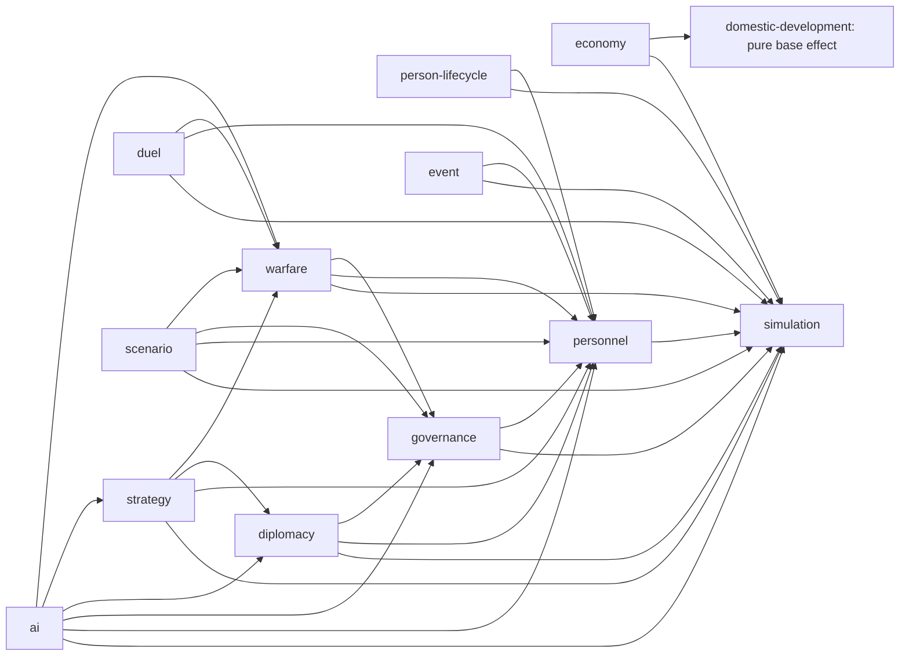

# 核心领域依赖图与实现入口

- 状态：已确认
- 最后更新：2026-09-16
- 机器契约：[core-domain-contracts.json](core-domain-contracts.json)
- 架构决策：[DEC-PROJECT-0001](../decisions/DEC-PROJECT-0001-layered-architecture.md)、[DEC-PROJECT-0002](../decisions/DEC-PROJECT-0002-selective-inheritance.md)、[DEC-SIM-0001](../decisions/DEC-SIM-0001-determinism-and-saves.md)

## 契约边界

本图只聚合状态为“已确认”的行为规格。`objects`、`states`、`inputs`、`outputs`、`invariants` 和验收门是产品实现入口；原版地址、任务码、固定数组、反编译符号和未确认字段不是产品契约。计划路径表示首个实现落点，不表示功能已经完成。

规则只存在于 `San9.Core`。`San9.Application` 组合用例和领域服务；`San9.Content` 提供规范化内容；导入器只在离线转换时运行；Godot 客户端只提交请求并消费只读快照。

## 依赖关系

箭头表示“消费者依赖契约提供者”。依赖图无环；`simulation` 只提供时钟、命令、随机、事务和快照基础，不反向引用具体玩法领域。

实际交付顺序以[路线图](../roadmap.md)为准：先完成时间/命令、保存与经营底座，再接入人事治理和战争，随后补齐其他领域。上图表示契约依赖，不要求一个上游领域全部完成后才开始下游切片。各阶段复用点、缺失输入和代表性场景见[G00实施基线](../roadmap-baseline.md)；逻辑提交顺序仍由模拟流水线串行确定。

G04人事与基础治理已接入。`PersonnelTransitions`拥有人物归属/地点和引用任务清理，`PersonnelReturns`拥有归队，`GovernanceMaintenance`拥有负责人/都督修复；`CorpsGovernance`维护辖区与独立账户，`CorpsControl`统一权限。Application的`AutomaticCorpsPlanner`通过同一Core命令执行有限人事/经营；保存、录像与CLI复用G02。内容同步官职能力/爵位、宝物、地点和服务单位分类；证据见[G04验收](../../docs/g04-verification.md)。

G05 移动链已接入：`BattlefieldMap`负责不可变拓扑、矩形和四向路径，`MilitaryRulebook`消费规范化阵型与据点入口，`MilitaryMovement`在候选事务内负责出征、每日命令、载荷和返城吸收。成员位置由`OfficerState.UnitId`唯一引用，俸禄随单位军团账户，查询及保存消费同一状态。Content的`MilitaryDefinition`由版本Importer生成，Core不读取显示地图；现有规则及验证见[G05推进记录](../../docs/g05-verification.md)。G06已由`MilitaryCombat`接入普通交战，`BattleAftermath`统筹占领和战败，`BattlePersonnel`与`UnitTerminationService`处理人员和兵员/账户，日历流水线消费势力退出事件并判定初步终局；证据见[G06验收](../../docs/g06-verification.md)。

验收条款以各BEH原文为准；当前覆盖由领域契约验证器生成，不在此重复维护计数。

## 核心领域契约

`domestic-development` 是四项内政随机加倍前的纯计算入口，已由 `San9.Core.Domain.DomesticDevelopment` 实现；它没有模拟调度依赖。`economy`依赖该计算与`simulation`，由BEH-ECONOMY-0001定义多人六项命令、共享资源账户及周期经济；Application通过`DomesticPlanner`和公共命令运行确定性简单策略。经济状态、名义规则输入及事件同步存档、内容指纹和录像。

| 领域 | 已确认规格 | 对象与状态 | 输入 → 输出 | 关键不变量 | 首个实现入口 |
| --- | --- | --- | --- | --- | --- |
| `simulation` | `BEH-SIMULATION-0001` | 日历、周期流水线、控制席位、命令序号水位、持续任务和命名随机；稳定/执行/终局 | 命令日志、世界与随机状态 → 快照、领域事件、派生日历 | 单一权威日期；单活动阶段；权限终验；持续占用；拒绝零副作用；稳定快照恢复 | `San9.Core.Simulation`：`SimulationEngine`、`ResolutionPipeline` |
| `personnel` | `BEH-PERSON-0001..0003` | 人物、归属、忠诚、地点、行动占用 | 人事命令与实时归属 → 原子归属变化、忠诚/宝物转移、占用释放 | 单一归属/地点；失败零写回；宝物唯一；占用必释放 | `San9.Core.Simulation`：`PersonnelMissions`、`PersonnelTransitions`、`PersonnelReturns`、`PersonnelOffices`、`PersonnelRewards`、`PersonnelTreasures`、忠诚周期 |
| `person-lifecycle` | `BEH-PERSON-LIFECYCLE-0001..0002`；0003为独立支线草案 | 成长、伤势、生命 | 周期、人物、成长/死亡原因 → 成长、登场/恢复、死亡清理 | 成长有界；死亡无活引用；旬恢复恰一次 | `San9.Core.Simulation`：`OfficerInjuryRecovery`与`OfficerAppearance`已接入周期、新局、事件及保存恢复；`OfficerDeath`已统一战争死亡清理，`NaturalMortality`与`RulerSuccession`接入季度自然死亡及自动继任；`PrisonerExecution`已接入处决与可保存的玩家继任选择；`FreeOfficerMigration`已接入旬迁移及保存／录像，`TacticStudy`已接入季度报名、修行及直接授予；完整成长及单挑死亡的玩家继任选择待G09补齐；培养按需另行设计，不构成主线依赖 |
| `governance` | `BEH-GOVERNANCE-0001..0003` | 势力、军团、辖区、委任、归属事务 | 当前所有权与委任配置 → 自动命令、归属转换、军团清理 | 单一势力根；资源守恒；自动/交互共享终验 | `San9.Core.Simulation`：`CorpsGovernance`、`CorpsControl`、`GovernanceMaintenance`、`PersonnelDefection`；Application：`AutomaticCorpsPlanner`（基础策略） |
| `diplomacy` | `BEH-DIPLOMACY-0001..0003` | 关系、联盟、外交命令、谈判、计划 | 关系快照、请求、资格、随机流 → 对称关系、守恒结算、联盟、计划 | 关系对称有界；联盟显式；增量规划读取实时状态 | `San9.Core.Simulation.ForceRelations/AllianceDiplomacy/AllianceFormation`及四类外交结算器已接入；`PendingDailyTask`保存分阶段谈判；Application有限自动外交已验收 |
| `warfare` | `BEH-WAR-0001..0006` | 部队、移动计划、战场命令、兵法冷却、设施建设与战斗、终止结算 | 命令、地图占用、实时目标 → 日移动、兵法、建设、占领、部队/势力清理输入 | 不穿硬阻挡；效果只提交一次；重置后无活引用 | `San9.Core.Simulation`：移动、兵法、建设、占领与终止服务 |
| `ai` | `BEH-AI-0001` | 势力视角观察、确定性预算、计划、诊断 | 不可变观察、命名用途、预算 → 有序命令候选、评分、可选诊断 | 不持有可变世界；分析随机隔离；诊断不改行为；共享命令终验 | `San9.Core.AI`：`AiObservation`、`AiPlanningContext`、`AiPlan`、`IAiPlanner` |
| `strategy` | `BEH-STRATEGY-0001..0003` | 计略命令、目标、意见、部队状态、结果 | 单执行者、类型目标、实时阈值、随机流 → 目标效果、成长、占用释放 | 意见只读；玩家/AI 共用结算；资源与所有权有界 | `San9.Core.Simulation.UnitStrategies/AlienateStrategies/BurnStrategies/SeizeStrategies/GossipStrategies/AdviserJudgment`：八类计略命令、意见、效果与返程均已接入；Application `StrategyPlanner`复用公共验证，阶段审计及保存／重放已验收 |
| `duel` | `BEH-DUEL-0001..0003` | 单挑机会、名单、逐刀、结果、战后结算 | 陆战攻击机会、名单、属性、随机流 → 名单、逐刀结果、人员分区、士气、低武力胜者成长 | 单刀单结果；死亡/俘虏/伤势互斥；表现随机隔离；成长每场至多一次 | `San9.Core.Duels`：触发、解析与战后服务 |
| `event` | `BEH-EVENT-0001..0002` | 候选、会话、结果、持久键、触发器 | 命名触发、候选表、只读世界、随机流 → 活动事件、原子效果、消费键 | 单活动事件；游标单调；效果与消费键同批提交 | `San9.Core.Events`：选择、会话与提交服务 |
| `scenario` | `BEH-SCENARIO-0001..0002` | 终局判定、终局结果、结局快照、责任者、结局结果 | 不可变世界/结局快照 → 唯一终局结果与唯一结局 | 终局互斥；战争不创建 UI 结局；结局解析为纯函数 | `San9.Core.Scenarios`：`TerminalEvaluator`、`EndingResolver` |

G01已接入以上模拟内核与现有内政命令，持续任务通过内部领域规则夹具验收；尚未实现人事/战争任务、实际终局条件或磁盘存档。证据与运行入口见[G01验收](../../docs/g01-verification.md)。

## 支撑边界

G07已接入的周期入口：`PrisonerEscapeCycle`在旬更新复用`PrisonerRelease`的安置与归队；`WoundedRecovery`读取`BattlefieldPlace.WoundedRecovery`并等量转换据点伤兵和现役。两者使用独立命名随机流。`MilitarySupply`消费本日账户短缺，统一写士气并复用终止清理；`UnitReformation`处理显式整编及共同可通行地形上的陆水转换，军事进出统一使用建筑边界。结果进入统一世界状态、保存和事件协议；`FormationEligibility`统一出征/整编的成员、势力和持有宝物技术资格。`TacticCombat`、`IntelligenceTactics`与`FacilityCombat`消费当前成员、命名随机及内容能力，冷却和异常属于权威状态；`FacilityConstruction`持有施工计划和地域实例双向引用。石兵反作用复用兵损与异常写回，地利／落石范围由当前地图和建筑状态查询，不保存第二份人工维护的覆盖集合。G07验收见[完成记录](../../docs/g07-verification.md)。

| 边界 | 规格 | 职责 | 实现入口 |
| --- | --- | --- | --- |
| `content-import` | `BEH-IMPORT-0001..0017` | 识别批准样本、无损解码已知/未知字段、生成稳定内容 ID 与规范化内容包；不进入运行时依赖 | `San9.Importer.San9PkTc101` 与 `San9.Content` |
| `presentation` | `BEH-RENDER-0001..0004`、`BEH-UI-0001` | 消费只读快照和内容资产，组织地图、动画、完整视野提交、选择与固定UI；不拥有规则真值或玩法随机 | `San9.Rendering`、`San9.Application` 与 `San9.Client.Godot` |

## 决策门

| 类别 | 已批准决策 | 实现约束 |
| --- | --- | --- |
| 现代 AI 规划边界 | `DEC-AI-0001` | 势力视角不可变观察、确定性工作预算、分析随机隔离、诊断无行为影响、公共命令终验 |
| 确定性系统替换 | `DEC-SIM-0001` | 类型化命令、命名稳定随机流、显式随机/世界存档和固定提交顺序 |
| 现代领域模型 | `DEC-PROJECT-0002` | 保留被规格选用的关系，以现代对象替换原版存储和任务结构 |
| 单挑无效随机删除 | `DEC-PROJECT-0002` | 不消费已选初始人物的无效追加骰 |
| 单挑低武力胜者成长 | `DEC-DUEL-0001` | 采用攻略书与非 PK 版规则：分组胜者单挑开始时当前有效武力较低时基础武力 +1，每场至多一次，不消费随机 |
| 神兽事件概率调整 | `DEC-EVENT-0001` | 使用已批准的连续有效武力公式 |
| 事件内容分离 | `DEC-DATA-0001` | 规则只消费稳定内容键和类型化条件/效果 |
| 登用失败忠诚 | `DEC-PERSON-0001` | 失败扣减所属势力忠诚，保留已批准的专项调整 |
| 固定逻辑画布 | `DEC-UI-0001` | 4:3逻辑画布等比缩放 |
| 现代文字效果 | `DEC-UI-0002` | 保留文字角色，以现代字体和批准的效果近似呈现 |
| 四季纹理与透明混合 | `DEC-RENDER-0002` | 转换四季纹理、标准Alpha，显示不消费模拟状态 |
| 连续相机边界 | `DEC-UI-0003` | 沿视觉地图边界连续限制，不吸附格心 |
| 高色深地图 | `DEC-RENDER-0001` | 保留坐标与混合关系，输出改为 RGB888 |

当前聚合契约没有登记中的核心规格冲突；这不表示各研究公式的全部输入或范围外规则已经闭合，具体见[研究与规格疑点清单](../../research/research-open-questions.md)。未确认的字段标签、UI 名称、挑战剧本布局和可选细节保持在各规格的排除范围，不能进入上述类型或验证器。新的规则或语义差异须更新相关 BEH 并明确可执行验收场景；是否新增 DEC 按[文档规则](../README.md)判断。

## 保存与无界面边界

`session-persistence`依赖`simulation`，已确认规格为`BEH-SAVE-0001`。Core的`CanonicalJson`提供规范化编码与按需诊断摘要，普通快照不携带摘要；Application持有内容/规则身份、操作水位、轻量保存恢复、独立录像及原子会话发布；独立`San9.Headless`只消费Application，不拥有领域规则。G03新增相性、精通、基础信望、容量与粮耗资格，规范化组合对和官职俸禄成为经济输入。后续新增领域状态、规则输入与动态身份必须同步保存、恢复校验、指纹和重放测试。实际入口为`SaveService`、`CommandLogService`与`HeadlessHost`，验证见[G02验收](../../docs/g02-verification.md)。
